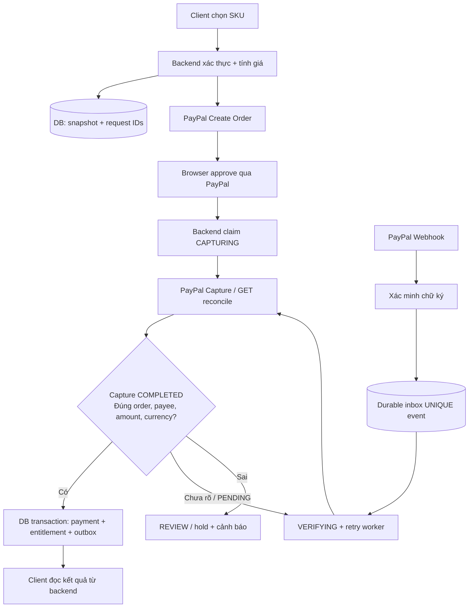

# Hướng dẫn tích hợp PayPal an toàn và security review

**Dự án:** SheetAutomate.com  
**Ngày rà soát:** 23/10/2026 — Asia/Ho_Chi_Minh  
**Phạm vi:** kiến trúc Checkout/Orders v2 cho thanh toán một lần, hàng số/dịch vụ; rà soát tĩnh repo hiện tại; thiết kế backend TypeScript/Express/PostgreSQL và frontend React.  
**Trạng thái:** tài liệu thiết kế và mã tham chiếu; chưa triển khai thanh toán, chưa chạy giao dịch Sandbox/Live.

> Mục tiêu là giảm tối đa nguy cơ lộ bí mật, thu tiền trùng, cấp hàng khi chưa nhận tiền và bị lợi dụng để thử thẻ. Không có tích hợp nào bảo đảm tuyệt đối không có gian lận, chargeback, hold hay limitation. Các kiểm soát kỹ thuật phải đi cùng điều kiện của tài khoản và quy trình vận hành.

## Mục lục

1. [Kết quả review repo và phạm vi bảo đảm](#1-kết-quả-review-repo-và-phạm-vi-bảo-đảm)
2. [Security architecture và zero-trust client](#2-security-architecture-và-zero-trust-client)
3. [Bảo vệ dữ liệu, credential và lỗi](#3-bảo-vệ-dữ-liệu-credential-và-lỗi)
4. [Chống mất tiền và gian lận giao dịch](#4-chống-mất-tiền-và-gian-lận-giao-dịch)
5. [Webhook verification, replay và SSRF](#5-webhook-verification-replay-và-ssrf)
6. [Carding, bảo vệ tài khoản và Seller Protection](#6-carding-bảo-vệ-tài-khoản-và-seller-protection)
7. [Mã tham chiếu backend](#7-mã-tham-chiếu-backend)
8. [Mã tham chiếu frontend React](#8-mã-tham-chiếu-frontend-react)
9. [Vận hành, đối soát và xử lý sự cố](#9-vận-hành-đối-soát-và-xử-lý-sự-cố)
10. [Checklist kiểm thử và audit trước Go-Live](#10-checklist-kiểm-thử-và-audit-trước-go-live)
11. [Nguồn chính thức và các điểm cần kiểm tra lại](#11-nguồn-chính-thức-và-các-điểm-cần-kiểm-tra-lại)

## 1. Kết quả review repo và phạm vi bảo đảm

### 1.1. Bằng chứng và phát hiện

Đã đọc `package.json`, `vite.config.ts`, `.gitignore`, `public/_headers`, `src/App.tsx`, `src/components/IntakeModal.tsx`; tìm các dấu hiệu payment/checkout/webhook/PayPal và credential trong mã ứng dụng. Không in giá trị credential hay dữ liệu khách hàng vào báo cáo.

| ID | Mức độ / trạng thái | Bằng chứng | Kết luận và yêu cầu |
|---|---|---|---|
| R-01 | Chặn Go-Live thanh toán; chức năng chưa có | `package.json` chỉ khai báo frontend Vite/React; không có Express/Fastify, DB hoặc PayPal SDK | Cần backend và database riêng. Không thêm Client Secret vào Vite để thay thế backend. Đây là khoảng trống tích hợp, chưa phải lỗi khai thác được của một checkout đang tồn tại. |
| R-02 | Cao nếu đưa secret vào frontend | `vite.config.ts` là cấu hình Vite thông thường | Mọi biến `VITE_*` được sử dụng trong client có thể vào bundle. Chỉ cho phép Client ID công khai; credential phải nằm ở môi trường runtime backend. |
| R-03 | Trung bình; cần khắc phục trước khi thêm secret | `.gitignore` có `*.local`, chưa có quy tắc tổng quát `.env`, `.env.*` | Bổ sung ignore, secret scanning và kiểm soát CI. Không coi `.gitignore` là công cụ xóa secret đã commit. |
| R-04 | Chặn tự động giao hàng | `IntakeModal.tsx` tạo `mailto:` và chuyển sang màn hình submitted; chưa gọi payment backend | Submitted hiện chỉ là gửi yêu cầu. Tuyệt đối không dùng trạng thái này làm paid; lời hứa dispatch hàng số cần gắn với payment + fulfillment thật. |
| R-05 | Cần tăng cường cho trang checkout | `public/_headers` có nosniff, referrer policy, X-Frame-Options; chưa khai báo CSP/HSTS tại file này | Thiết kế CSP tương thích PayPal và Turnstile, thử Report-Only, kiểm tra header thực tế ở hosting/CDN. Chưa kết luận website đang thiếu header trên production. |
| R-06 | Chưa có bằng chứng lộ PayPal secret trong phần mã đã đọc | Không tìm thấy PayPal integration hoặc credential PayPal trong mã ứng dụng được rà soát | Không đồng nghĩa toàn repo, lịch sử Git, CI, cloud secret, log và bản deploy đã được chứng nhận an toàn. |

**Giới hạn review:** chưa pentest domain đang chạy; chưa kiểm tra dashboard PayPal, môi trường deploy, quyền IAM, cấu hình DB, secret store, lịch sử Git đầy đủ hay dependency CVE qua dịch vụ trực tuyến. Không truy cập tài khoản, không phát sinh giao dịch và không sửa mã ứng dụng trong lần biên soạn này. Checklist cuối tài liệu là tiêu chí nghiệm thu, không phải danh sách kiểm thử đã hoàn thành.

### 1.2. Threat model

Tài sản cần bảo vệ: credential PayPal, tiền và sổ giao dịch, quyền truy cập sản phẩm, PII, tài khoản quản trị và bằng chứng giao hàng. Đối thủ có thể kiểm soát hoàn toàn browser, gọi API bằng script, có tài khoản khách hợp lệ, phát lại request, thay đổi Order ID, gửi webhook giả, làm gián đoạn kết nối và chạy bot phân tán.

| Ranh giới tin cậy | Rủi ro | Kiểm soát bắt buộc |
|---|---|---|
| Browser → API | sửa giá, IDOR, CSRF, bot | schema chặt, session, ownership, CSRF, tính giá server, chống bot |
| API → PayPal | lộ token, SSRF, timeout không rõ kết quả | OAuth server-only, endpoint cố định, timeout, idempotency, đối soát |
| PayPal → webhook | giả mạo, phát lại, event đến sai thứ tự | xác minh chữ ký, durable inbox, unique event, state machine |
| API/worker → DB | race, cấp hai lần, rollback | transaction, unique constraint, lease, entitlement/outbox idempotency |
| DB → delivery provider | crash sau khi gửi nhưng trước khi đánh dấu | khóa nghiệp vụ cố định và API đích hỗ trợ idempotency hoặc đối soát |
| Quản trị / CI | chiếm tài khoản, log secret | MFA, least privilege, secret manager, audit và rotation |

### 1.3. Kiểm tra đã thực hiện với mã trong tài liệu

- Trích xuất 6 module TypeScript và component React từ chính các code block; `tsc --noEmit` với TypeScript 5.9.3 và chế độ strict: **đạt**. Đã kiểm tra với Express 5.3.0, pg 8.23.1, Zod 4.6.7, React 18 và `@paypal/react-paypal-js` 10.6.0. Đây là các phiên bản dùng khi kiểm tra, không thay thế việc review dependency lúc deploy.
- **57 assertions đạt** với HTTP PayPal giả lập và PostgreSQL nhúng PGlite 0.5.11: chuyển đổi tiền chính xác; từ chối price field lạ; kiểm tra certificate URL; retry create; attempt/SKU conflict; ownership; timeout sau capture; idempotent finalize; rollback payment/entitlement khi outbox lỗi; phục hồi không capture lại; pending không cấp quyền; amount mismatch; webhook verify failure/duplicate header; bảo toàn raw JSON; duplicate event; refund hold/revoke; unique capture constraint.
- Kiểm tra được thực hiện trong thư mục tạm riêng, không thay đổi `package.json`/lockfile hoặc ứng dụng hiện tại, không dùng credential thật và không phát sinh giao dịch.
- **Chưa kiểm chứng:** chữ ký từ PayPal thật, behavior SDK trong browser, session/proxy/CSP trên hosting, concurrency của nhiều process với PostgreSQL production, crash của máy chủ thực tế, quota và các điều kiện tài khoản merchant. PostgreSQL nhúng dùng để kiểm tra schema/transaction tuần tự; không chứng nhận locking phân tán hoặc toàn bộ checklist Go-Live.

## 2. Security architecture và zero-trust client

### 2.1. Luồng chuẩn

PayPal Orders API v2 cung cấp create, read và capture order. OAuth access token được lấy từ backend bằng Client Credentials. [Orders v2](https://developer.paypal.com/api/orders/v2/), [Authentication](https://developer.paypal.com/api/rest/authentication/).

```text
CLIENT (không tin cậy)      BACKEND (quyết định)         PAYPAL API          DATABASE
        |                           |                      |                  |
        | SKU + attempt key         |                      |                  |
        | + CSRF + anti-bot ------->| xác thực, tính giá    |                  |
        |                           |-------------------------------> lưu snapshot
        |                           | POST /orders -------->|                 |
        |                           |<-- PayPal Order ID ---|                 |
        |                           |-------------------------------> lưu mapping
        |<-- chỉ Order ID ----------|                      |                  |
        |                           |                      |                  |
        | mở PayPal SDK; buyer approve ------------------->|                  |
        | onApprove(orderID) ------>| kiểm tra ownership   |                  |
        |                           |-------------------------------> claim lease
        |                           | GET order; POST capture ------>|        |
        |                           |<-- kết quả / timeout --|                |
        |                           | GET đối soát ---------->|               |
        |                           | kiểm tra capture, payee, amount         |
        |                           |-------------------------------> TX atomic:
        |                           |   capture UNIQUE + COMPLETED + entitlement/outbox
        |<-- trạng thái tối thiểu --|                      |                  |
        |                           |                      |                  |
        |                           |<-- webhook đã ký -----|                 |
        |                           | verify signature ---->|                 |
        |                           |-------------------------------> durable inbox
        |                           |-- 2xx sau commit ---->|                 |
        |                           | worker dùng cùng logic đối soát / finalize
```



### 2.2. Các bất biến không được phá vỡ

1. Browser không quyết định giá, currency, discount, thuế, merchant nhận tiền, quyền sở hữu order hay trạng thái paid.
2. `onApprove`, return URL, query `success=true`, ảnh chụp chuyển tiền và email xác nhận không phải bằng chứng đủ để cấp hàng.
3. Chỉ backend thực hiện OAuth và gọi create/capture. Browser dùng PayPal SDK cho trải nghiệm người mua.
4. Chỉ một nguồn logic `finalize` quyết định paid; response capture và webhook đều hội tụ vào đó.
5. Cấp tài nguyên sau **capture thực tế có status COMPLETED**, đối chiếu snapshot giá, currency, merchant và mapping đơn hàng. Order approved/authorized hoặc capture pending không đủ.
6. Không thể gói HTTP tới PayPal và transaction DB thành một ACID transaction. Phải thiết kế phục hồi khi một bên đã thành công.
7. Có thể tin nguồn PayPal đã xác minh về dữ kiện giao dịch; vẫn phải kiểm tra giao dịch đó có thuộc đúng order, môi trường, merchant và khách hàng của ứng dụng.

### 2.3. API contract tối thiểu

| API | Input được nhận | Output công khai |
|---|---|---|
| `GET /api/paypal/bootstrap` | session cookie | Client ID công khai, currency cấu hình, CSRF token |
| `POST /api/paypal/orders` | SKU công khai, `attemptKey` ngẫu nhiên, anti-bot token; CSRF header | `{ orderID }` hoặc mã processing/lỗi đã chuẩn hóa |
| `POST /api/paypal/orders/:orderID/capture` | chỉ Order ID; CSRF header | `{ status: COMPLETED hoặc PROCESSING }` |
| `GET /api/paypal/orders/:orderID/status` | Order ID + session | trạng thái đã lọc, trạng thái quyền truy cập |
| `POST /webhooks/paypal` | bytes JSON gốc + header PayPal | 204 sau verify và commit inbox |

“Frontend chỉ truyền Order ID” áp dụng cho capture. Lúc create, frontend vẫn cần thể hiện lựa chọn sản phẩm bằng SKU; backend tự tính giá. `attemptKey` giúp gộp retry một ý định mua, không cấp quyền và không thay thế request ID server. Không truyền internal primary key, amount hoặc currency theo quyết định của browser.

### 2.4. Session, authorization và quyền nhận hàng

- Với hàng số: ưu tiên session đăng nhập hoặc guest checkout session được ràng buộc server-side và xác minh email. Email PayPal không tự động chứng minh quyền sở hữu tài khoản ứng dụng.
- Mọi create/capture/status phải kiểm tra authenticated principal. Truy vấn order bằng **Order ID + account ID + environment**; trả cùng loại 404 cho không tồn tại và không thuộc sở hữu.
- Cookie session `HttpOnly; Secure; SameSite=Lax; Path=/`, host-only; nếu dùng tên `__Host-`, không khai báo Domain. Rotate session sau login, logout thực sự hủy session; MFA cho admin.
- CSRF token gắn session + kiểm tra Origin chính xác trên POST. CORS không thay authentication hay CSRF. Webhook không dùng browser CSRF/session; dùng chữ ký PayPal.
- Download/credit/license phải được kiểm tra quyền lại ở backend. URL tĩnh công khai của file trả phí sẽ bỏ qua toàn bộ checkout.

## 3. Bảo vệ dữ liệu, credential và lỗi

### 3.1. Phân loại dữ liệu

| Dữ liệu | Được xuất hiện ở frontend? | Quy tắc |
|---|---|---|
| PayPal Client ID | Có | Định danh ứng dụng công khai cho JS SDK; không phải Client Secret. |
| PayPal Order ID | Có, cho người sở hữu | Cần cho checkout; không phải credential hay authorization token. Không dùng tính khó đoán để thay ownership. |
| Client Secret | Tuyệt đối không | Backend runtime / secret manager; không Vite/Next public env, HTML, repo hay log. |
| OAuth REST access token | Tuyệt đối không | Cache ở backend trong thời gian ngắn; không localStorage, cookie browser hay network response tới client. |
| Webhook ID | Không cần công khai | Cấu hình server; không phải shared signing secret và không đủ để giả mạo chữ ký. |
| “Webhook Secret” tự đặt | Không | Nếu có trong gateway riêng thì chỉ giữ server-side; không thay verify chính thức. PayPal REST webhook không xác thực bằng shared HMAC secret của merchant. |
| DB credentials, session key, encryption key | Tuyệt đối không | Secret manager, phân quyền theo service. |
| Internal DB/account/tenant IDs | Không trong contract công khai | Dùng SKU, opaque public reference hoặc PayPal Order ID; luôn authorization server-side. UUID nội bộ cũng có thể lộ liên kết nghiệp vụ. |
| Capture/transaction ID | Thường không cần cho browser | Lưu server để đối soát; không phải secret nhưng giảm phát tán và liên kết dữ liệu. |
| PII payer, địa chỉ, email, IP | Chỉ tối thiểu theo nhu cầu | Không trả nguyên response PayPal; tách dữ liệu bằng chứng và quyền truy cập. |
| Client token dành riêng cho SDK | Tùy sản phẩm, ngoài mẫu này | Một số SDK có token thiết kế cho browser. Không nhầm loại đó với OAuth REST access token. |

Ẩn secret bằng base64, obfuscation, minification hoặc đưa vào source map vẫn là lộ secret. Backend serverless là hợp lệ nếu secret chỉ tồn tại trong runtime backend và không được bundler đưa vào client.

### 3.2. Biến môi trường và phân tách Sandbox/Live

Vite đưa các biến có tiền tố public `VITE_` được tham chiếu vào mã client. `.env` nằm trên server build không có nghĩa giá trị được giữ bí mật sau build. [Vite: Env Variables and Modes](https://vite.dev/guide/env-and-mode).

```dotenv
# BACKEND ONLY — mẫu placeholder, không chứa giá trị thật
PAYPAL_ENV=sandbox
PAYPAL_CLIENT_ID=replace-in-secret-manager
PAYPAL_CLIENT_SECRET=replace-in-secret-manager
PAYPAL_WEBHOOK_ID=replace-with-registered-webhook-id
PAYPAL_MERCHANT_ID=replace-with-expected-merchant-id
DATABASE_URL=postgresql://replace-at-runtime
SESSION_SECRET=replace-with-at-least-32-random-bytes
RATE_HASH_SECRET=replace-with-independent-random-key
TURNSTILE_SECRET_KEY=replace-in-secret-manager
APP_ORIGIN=https://checkout.example.com
PORT=3001
```

Frontend trong mẫu lấy Client ID từ bootstrap. Nếu dùng biến Vite thì chỉ:

```dotenv
VITE_PAYPAL_CLIENT_ID=public-client-id-only
# KHÔNG: VITE_PAYPAL_CLIENT_SECRET, VITE_PAYPAL_ACCESS_TOKEN, VITE_DATABASE_URL
```

Quy tắc `.gitignore` cần bổ sung khi triển khai:

```gitignore
.env
.env.*
!.env.example
*.pem
*.key
```

- `.env.example` chỉ có tên biến và placeholder. Không phục vụ `.env`, backup, database dump, document nội bộ qua static hosting.
- Sandbox và Live có app, Client ID/Secret, Webhook ID, merchant/test account, endpoint, DB/queue/log namespace riêng. Không cho request client chọn môi trường hay base URL.
- Sandbox: `https://api-m.sandbox.paypal.com`; Live: `https://api-m.paypal.com`. Cấu hình bằng enum allowlist; fail startup khi thiếu hoặc sai.
- Có thể dùng chung code, không dùng chung credential hay cơ sở dữ liệu nghiệp vụ. Gắn environment vào khóa uniqueness nếu dùng chung hạ tầng quản trị.
- Secret manager cấp secret qua workload identity; CI frontend không được đọc secret Live. Chặn deploy nếu phát hiện secret trong `dist/`, source maps, build logs, preview artifacts.
- Kiểm tra secret trong lịch sử Git, container layers, error tracking, CI artifacts. Nếu đã lộ: **rotate/revoke trước**, sau đó mới dọn lịch sử/cache và xác định thời gian phơi nhiễm.
- Quyền API của merchant phải tối thiểu theo sản phẩm hỗ trợ; không giả định có thể tạo scope hẹp tùy ý cho mọi REST app. Tách quyền hoàn tiền/quản trị khỏi ứng dụng public khi khả thi.

### 3.3. Error handling và sanitization

Response công khai chỉ gồm mã allowlist và request ID tự tạo:

```json
{
  "code": "PAYMENT_PROCESSING",
  "requestId": "opaque-server-generated-reference"
}
```

Không trả `error.message` trực tiếp từ SDK, SQL hay HTTP upstream. Không trả stack, toàn bộ `details`, `links`, `payer`, `payment_source`, `debug_id` hay nguyên capture object. Nếu cần thao tác khôi phục, map **một mã lỗi PayPal đã biết** sang mã nội bộ như `PAYMENT_ACTION_REQUIRED`; không chuyển tiếp payload.

Log bằng allowlist: `requestId`, operation, HTTP status upstream, mã nội bộ, PayPal debug reference nếu cần cho support trong hệ thống hạn chế truy cập. Không log Authorization/Basic/Bearer, cookie, CSRF, anti-bot token, raw request/response, database URL, email/IP thô theo mặc định. Sanitize cả reverse proxy, APM, tracing và exception serializer. Hash IP bằng HMAC để đếm rate; hash vẫn là dữ liệu cần hạn chế, không tự động trở thành dữ liệu vô danh.

Cấu hình `NODE_ENV=production`; error middleware JSON tùy chỉnh; chặn cache response thanh toán bằng `Cache-Control: no-store`; chặn ghi body ở endpoint OAuth/webhook/capture. Validation thất bại dùng thông báo tổng quát, không echo input. React render text bình thường; không dùng `dangerouslySetInnerHTML` cho nội dung PayPal/lỗi.

### 3.4. Browser và hạ tầng

TLS 1.2 trở lên; xác minh CA của kết nối tới PayPal và DB. Không `rejectUnauthorized: false`. HSTS chỉ bật đầy đủ khi toàn bộ hostname/subdomain liên quan đã hỗ trợ HTTPS. Hạn chế third-party analytics/session replay ở checkout; che form, tắt ghi network body và URL nhạy cảm.

CSP cần allowlist đúng tài nguyên SDK và anti-bot thực sự sử dụng; bắt đầu Report-Only trong staging, rồi enforce. Nếu dùng nonce, tạo nonce mới cho mỗi HTML response và truyền đúng vào SDK; không hardcode nonce cho site tĩnh. Không thêm `*`, `unsafe-eval` hoặc `unsafe-inline` chỉ để hết lỗi. PayPal có hướng dẫn truyền CSP nonce vào JS SDK. [PayPal browser/CSP guidance](https://developer.paypal.com/reference/guidelines/browser-support/).

Cần kiểm tra popup/redirect trên mobile. COOP/COEP quá chặt có thể phá liên lạc popup; kiểm thử cấu hình như `same-origin-allow-popups` nếu phù hợp, thay vì vô hiệu bảo mật tùy tiện. Không pin SRI giả cho URL SDK động; dùng cơ chế phân phối mà PayPal hỗ trợ và kiểm soát những script khác bằng SRI khi có phiên bản bất biến.

## 4. Chống mất tiền và gian lận giao dịch

### 4.1. Chống price tampering

Backend nhận `sku`, tìm catalog có hiệu lực, kiểm tra quyền mua và tính tổng từ dữ liệu server. Nếu có quantity, coupon, VAT, shipping hoặc tỷ giá, mọi quy tắc và làm tròn phải do server thực thi. Không dùng giá hiển thị trong React, trường hidden, URL, localStorage hoặc giá được ký bằng một khóa có trong frontend.

Lưu snapshot bất biến lúc tạo checkout: SKU/version, quantity, đơn giá, chiết khấu, thuế, tổng gross, currency, account, expected merchant, public payment reference. Thay đổi catalog sau đó không làm thay đổi số tiền của order đang thanh toán. Nếu quote hết hạn, không tự đổi giá của một order đã được approve/capture; chuyển sang luồng mới hoặc xử lý thủ công có kiểm soát.

Mẫu dưới giới hạn **một SKU, một purchase unit, một capture đầy đủ bằng USD**, không hỗ trợ partial/multi-capture, subscription, multiparty hay quy đổi tiền tệ. Tiền lưu bằng `bigint` minor units, format ra decimal string. Không dùng `parseFloat(value) * 100` hay epsilon để quyết định đủ tiền. Khi thêm JPY/HUF/currency khác, dùng bảng exponent và quy tắc decimal do PayPal hỗ trợ; không mặc định mọi currency có 2 số lẻ.

### 4.2. Idempotency, replay và “double spending”

Trong checkout, cần phân biệt: thu trùng cùng ý định mua; ghi nhận trùng cùng capture; và cấp credit/license trùng dù chỉ thu một lần. Header PayPal không giải quyết đủ cả ba.

| Khóa | Cấp bởi | Phạm vi và nơi lưu |
|---|---|---|
| `attemptKey` | Browser có thể tạo UUID | Unique theo account trong DB; retry create cùng ý định, so fingerprint SKU; không phải auth. |
| Create request ID | Backend | Một UUID lưu trước HTTP create; dùng lại khi retry đúng thao tác/body. |
| Capture request ID | Backend | UUID khác create, lưu trước capture; dùng lại khi retry đúng order. |
| PayPal Order ID | PayPal | Unique theo environment; gắn cố định với checkout và account. |
| Capture ID | PayPal | UNIQUE theo environment trong bảng payment; không gắn một capture cho hai checkout. |
| Webhook event ID | PayPal | UNIQUE theo environment và listener; chống xử lý lại cùng event. |
| Fulfillment operation key | Backend | Unique theo checkout và loại tài nguyên; dùng xuyên suốt DB, queue và nhà cung cấp đích. |

`PayPal-Request-Id` có thời hạn lưu tùy API/điều kiện. Không coi là vĩnh viễn, không lấy một con số chung cho mọi endpoint. Hướng dẫn Orders nêu cửa sổ 6 giờ trong một số luồng và khả năng thỏa thuận mở rộng; phải kiểm tra contract của endpoint/tài khoản thực dùng. Mẫu chọn ngân sách tự retry POST bảo thủ 15 phút và giữ idempotency nghiệp vụ trong DB lâu dài. [PayPal idempotency](https://developer.paypal.com/api/rest/reference/idempotency/), [Orders use cases](https://developer.paypal.com/api/rest/integration/orders-api/api-use-cases/advanced/).

Không sinh UUID mới mỗi lần retry capture. Không gọi create mới khi timeout vì “chắc chưa thanh toán”. Không để browser cung cấp trực tiếp header PayPal. Một khóa không được dùng lại cho body/operation khác. Hai request đồng thời cùng header vẫn có thể nhận lỗi cạnh tranh từ PayPal; DB lease phải giảm cạnh tranh trước khi gọi API.

### 4.3. State machine, locking và lease

```text
CREATING --create confirmed--> PENDING --claim lease--> CAPTURING
    |                             |                       |
    | timeout                     | chưa approved         | timeout / pending
    v                             v                       v
 retry cùng create key          PENDING                VERIFYING
    |                                                     |
    +--quá ngân sách--> REVIEW            GET reconcile / retry cùng capture key
                                                          |
                                               verified COMPLETED
                                                          v
                                                      COMPLETED

risk_hold = true là trục riêng: refund / reversal / dispute / mismatch
Không tự gỡ hold khi một event COMPLETED cũ đến muộn.
```

- Dùng `SELECT ... FOR UPDATE` trong transaction ngắn để claim lease/hoàn tất; hoặc CAS `UPDATE ... WHERE state=... RETURNING`.
- Không giữ khóa DB trong khi chờ HTTP PayPal. Commit lease trước, gọi API sau; khi cập nhật kết quả kiểm tra trạng thái/token lease để tránh worker cũ ghi đè worker mới.
- Lease phải có expiry và ownership token. Process chết ở CAPTURING phải được worker thu hồi để đối soát; không tự đặt thành unpaid rồi capture bằng khóa mới.
- Cùng một giao dịch DB phải ghi payment, trạng thái COMPLETED, entitlement/outbox. Không gửi email hoặc tạo tài nguyên bên ngoài ở giữa transaction rồi hy vọng rollback sẽ thu hồi được.
- Refund/reversal là bản ghi nghiệp vụ sau thanh toán, không xóa lịch sử COMPLETED. Duy trì financial ledger riêng khi triển khai hoàn tiền/đối soát phí.
- Nếu bán credits, mỗi capture chỉ tạo một ledger credit có unique operation key. Khi tiêu credit: atomic decrement có điều kiện balance đủ, ledger debit unique; đây là lớp chống double spending tài nguyên, tách khỏi capture.

### 4.4. Kiểm tra trước fulfillment

Đọc lại order bằng endpoint cố định do backend ghép từ ID đã validate. Với thiết kế một capture:

1. Order ID khớp mapping server; intent đúng; đúng một purchase unit.
2. `purchase_units[0].custom_id` khớp public payment reference ngẫu nhiên đã lưu, không dùng internal DB ID.
3. Merchant/payee ID khớp merchant cấu hình và snapshot. Không so email merchant làm định danh chính.
4. Purchase-unit gross amount và currency khớp snapshot.
5. Có đúng một capture; capture status `COMPLETED`, `final_capture=true`; capture amount/currency khớp snapshot.
6. Capture ID chưa từng thuộc checkout khác; environment đúng; không có risk hold hoặc adverse event đã xác minh chờ xử lý.
7. Commit payment + entitlement/outbox atomically trước khi trả COMPLETED.

Đối chiếu **gross capture**, không so `net_amount` sau phí. USD 5.00 gross và USD 4.x net có thể hợp lệ; giá USD 5.00 nhưng capture 0.05 hoặc currency khác phải chặn. Tiền “COMPLETED” vẫn có thể bị refund/reversal hoặc bị hạn chế rút; không coi đó là bảo đảm không chargeback. Capture response có lựa chọn `Prefer: return=representation`, nhưng vẫn lọc DTO và đọc lại khi cần. [Capture order](https://developer.paypal.com/api/orders/v2/orders-capture), [Capture status](https://developer.paypal.com/api/payments/v2/definitions/capture_status/).

## 5. Webhook verification, replay và SSRF

### 5.1. Vì sao bắt buộc trong kiến trúc này

Có thể PayPal đã capture nhưng browser đóng, `onApprove` không chạy xong, backend timeout hoặc DB tạm mất kết nối. Chỉ dựa callback frontend sẽ làm khách đã trả tiền mà không được hàng. Refund/dispute còn có thể phát sinh từ dashboard hoặc bên ngoài phiên checkout. Webhook là bắt buộc **theo thiết kế tin cậy của hệ thống này**, đi kèm scheduled reconciliation; không khẳng định mọi sản phẩm PayPal đều bắt buộc webhook để gọi API.

PayPal retry delivery không nhận 2xx, tối đa 25 lần trong khoảng 3 ngày theo hướng dẫn webhook; vẫn cần job đối soát vì webhook có thể thất bại lâu hơn cửa sổ retry. Chỉ ACK sau khi sự kiện hợp lệ đã được lưu bền vững. [Webhooks overview](https://developer.paypal.com/api/webhooks/overview/).

### 5.2. Dữ liệu xác minh

| Header HTTP, không phân biệt hoa thường | Trường gửi API verify |
|---|---|
| `PAYPAL-AUTH-ALGO` | `auth_algo` |
| `PAYPAL-CERT-URL` | `cert_url` |
| `PAYPAL-TRANSMISSION-ID` | `transmission_id` |
| `PAYPAL-TRANSMISSION-SIG` | `transmission_sig` |
| `PAYPAL-TRANSMISSION-TIME` | `transmission_time` |
| Webhook ID lấy từ server config | `webhook_id` |
| Event nhận được, không chỉnh sửa | `webhook_event` |

Đối chiếu các trường trên với [Verify webhook signature API](https://developer.paypal.com/api/webhooks/v1/verify-webhook-signature-post). Mẫu dùng `POST /v1/notifications/verify-webhook-signature` trên base URL cố định đúng environment. Chỉ chấp nhận `verification_status === "SUCCESS"`. OAuth token của API verify nằm ở backend. Không lấy Webhook ID từ request, không dùng một ID chung cho Sandbox và Live.

Có thể self-verify bằng chữ ký RSA theo tài liệu REST: chuỗi ký gồm `transmissionId|transmissionTime|webhookId|crc32(rawBody)`, CRC32 unsigned dạng decimal của bytes gốc. Không thay bằng SHA256 body, `JSON.stringify(req.body)` hay HMAC tự nghĩ ra. Nếu dùng postback, bảo toàn JSON event gốc trong trường `webhook_event`; mẫu ghép raw JSON đã parse kiểm tra mà không serialize lại event. Simulator có hạn chế: postback verify không hỗ trợ mock event; kiểm thử end-to-end bằng giao dịch Sandbox thật. [Integrate REST webhooks](https://developer.paypal.com/api/rest/webhooks/rest/).

### 5.3. Chống SSRF và lạm dụng verifier

`cert_url` do request gửi tới, phải coi là dữ liệu không tin cậy trước verify. Không `fetch(req.headers['paypal-cert-url'])`, không theo `links[].href` trong payload.

- Chỉ HTTPS, không username/password, không fragment/query, không port lạ.
- Allowlist **hostname chính xác** theo môi trường: ví dụ `api.paypal.com`, `api-m.paypal.com` cho Live; `api.sandbox.paypal.com`, `api-m.sandbox.paypal.com` cho Sandbox. Ràng buộc path `/v1/notifications/certs/CERT-...`. Theo dõi thay đổi từ PayPal; nếu thay đổi, fail closed và cập nhật có kiểm chứng.
- Không dùng `hostname.endsWith('paypal.com')`; chuỗi như `evilpaypal.com` có thể qua kiểm tra sai. Không cho toàn bộ `*.paypal.com` nếu chỉ cần vài host xác định.
- Mẫu không fetch certificate trực tiếp nên không có HTTP client-side SSRF từ URL đó. Vẫn validate trước khi chuyển tới verifier và chặn redirect ở mọi HTTP outbound.
- Nếu tự tải certificate: thêm egress firewall/allowlist, chống DNS rebinding, chặn IP private/link-local/loopback/metadata cả IPv4/IPv6, pin DNS resolution trong kết nối, giới hạn bytes/timeout/cache có TTL, kiểm tra certificate/algorithm. Không dùng một đoạn regex đơn lẻ như giải pháp đầy đủ cho self-verification.
- Chặn request quá lớn, malformed/duplicate headers tại proxy, tốc độ bất thường trước API verify. IP allowlist của nguồn chỉ là lớp phụ nếu PayPal công bố phạm vi phù hợp, không thay chữ ký.

### 5.4. Idempotency, retry và event sai thứ tự

Dùng event ID làm khóa nghiệp vụ; transmission ID có thể khác giữa delivery. Inbox cần trạng thái PENDING/PROCESSING/DONE/REVIEW, retry count, next_attempt và lease expiry. Insert `ON CONFLICT DO NOTHING` chỉ chống duplicate nhận; nếu process crash sau insert, worker phải tìm lại hàng chưa DONE. Không dùng `Set` trong RAM, không ACK rồi `setTimeout(processEvent)`.

Kiểm tra timestamp hợp lệ, NTP và độ lệch tương lai; không áp một cửa sổ 5 phút lên **event create_time** rồi loại mọi retry muộn. Replay hợp lệ cũ không được gây side effect nhờ unique event, capture và entitlement. Nếu đặt giới hạn tuổi transmission, phải phù hợp delivery retry/manual resend đã kiểm thử và có đường phục hồi đối soát.

| Event | Hành động |
|---|---|
| `CHECKOUT.ORDER.APPROVED` | Xác minh mapping rồi có thể capture server-side bằng cùng khóa; không cấp hàng chỉ vì approved. |
| `PAYMENT.CAPTURE.COMPLETED` | Đọc order hiện tại, đối chiếu đầy đủ, finalize idempotent. |
| `PAYMENT.CAPTURE.PENDING` | Đối soát; giữ processing, không cấp hàng. |
| `PAYMENT.CAPTURE.DENIED` | Hold/review, đọc trạng thái hiện tại và ghi nhận thất bại phù hợp. |
| `PAYMENT.CAPTURE.REFUNDED` | Hold, tạm ngưng tài nguyên có thể thu hồi; đối soát refund riêng để phân biệt partial/full. |
| `PAYMENT.CAPTURE.REVERSED` | Hold/revoke theo chính sách, cảnh báo tài chính. |
| `CUSTOMER.DISPUTE.CREATED/UPDATED/RESOLVED` | Hold/review và cập nhật hồ sơ tranh chấp; resolved không tự động có nghĩa seller thắng. |
| `CHECKOUT.PAYMENT-APPROVAL.REVERSED` | Ngừng tự capture, đối soát, không cấp hàng. |

Đăng ký event đúng app và đúng phiên bản sản phẩm; không trộn `PAYMENT.SALE.*` cũ với Orders v2 capture. Schema refund/dispute khác capture: `resource.id` của refund là **refund ID**, không phải capture ID; dùng related IDs/disputed transactions và API phù hợp. Event thiếu mapping phải vào retry/REVIEW có cảnh báo, không gắn vào khách dựa email. [Webhook event names](https://developer.paypal.com/api/rest/webhooks/event-names/), [Uncaptured payments](https://developer.paypal.com/v5/checkout/uncaptured-payments/).

## 6. Carding, bảo vệ tài khoản và Seller Protection

### 6.1. Carding/BIN attack

Bot có thể dùng checkout để thử số thẻ/CVV/expiry, phân tán IP và đăng ký nhiều tài khoản. Không cần mọi lần thử thành công để tạo thiệt hại: tải API, tín hiệu gian lận và ảnh hưởng vận hành merchant đều đáng quan tâm. Velocity controls là một lớp phòng thủ; Braintree mô tả rõ mục tiêu chống carding của risk threshold rules, nhưng không được suy rằng mọi tính năng Braintree đều có sẵn trong PayPal Checkout hoặc tài khoản VN. [Braintree risk threshold rules](https://developer.paypal.com/braintree/articles/guides/fraud-tools/basic/risk-threshold-rules/).

Defense in depth:

- Ưu tiên PayPal-hosted wallet checkout cho giai đoạn đầu; không tự thu PAN/CVV. Không mặc định Advanced Card Payments/Card Fields được hỗ trợ cho merchant Việt Nam; xác nhận eligibility thật trước khi bật.
- Edge WAF/bot controls trên create/capture/login và giới hạn kích thước body, concurrency, tốc độ toàn merchant. Không chỉ giới hạn UI.
- Rate limit phân tán theo account, session, IP prefix, ASN/country risk, SKU và merchant-wide counters; dùng trusted proxy config chính xác, không tin `X-Forwarded-For` từ Internet. Không chặn người dùng chỉ vì cùng NAT một cách máy móc.
- Mẫu khởi đầu: create 5/phút/account và 20/phút/IP; capture 12/phút/account và 40/phút/IP. Đây là giá trị thiết kế để hiệu chỉnh, không phải ngưỡng PayPal bảo đảm an toàn. Status polling có giới hạn riêng.
- CAPTCHA kiểm tra server-side trước create; ràng buộc hostname/action, token ngắn hạn và session risk. Sau một lần kiểm tra thành công, retry cùng checkout có thể dùng trạng thái risk đã lưu, không tái dùng token đã tiêu thụ.
- Với reCAPTCHA v3: verify token ở server, kiểm tra hostname, action và score; chọn ngưỡng theo telemetry, có step-up khi nghi vấn. Token hết hạn sau khoảng 2 phút. [reCAPTCHA v3](https://developers.google.com/recaptcha/docs/v3).
- Với Turnstile: Siteverify bắt buộc; token có hạn 300 giây và single-use; kiểm tra `success`, hostname và action. Site key công khai, secret key backend-only. [Turnstile validation](https://developers.cloudflare.com/turnstile/get-started/server-side-validation/).
- Theo dõi create-to-approve ratio, decline ratio, attempts/account/IP, giá trị nhỏ lặp lại, số order chưa hoàn tất. Không ghi/log BIN, PAN/CVV để tự xây detector nếu sản phẩm không cung cấp dữ liệu hợp lệ đó.
- Không gửi chi tiết “CVV đúng/sai”, “thẻ tồn tại” cho browser. Khóa kênh tạo giao dịch mới khi có chiến dịch bot; vẫn để webhook và đối soát giao dịch cũ hoạt động.
- Không bắt CAPTCHA trên webhook PayPal. Bảo vệ endpoint webhook bằng giới hạn riêng để tránh bot làm cạn quota verifier nhưng không chặn delivery hợp lệ.

### 6.2. Bảo vệ tài khoản merchant

Dùng PayPal Business phù hợp hoạt động; KYC và thông tin cư trú/pháp nhân chính xác. Bật MFA/passkey nếu được hỗ trợ, bảo vệ email khôi phục bằng MFA, không chia sẻ mật khẩu; cấp quyền nhân viên riêng và rà soát thiết bị đăng nhập. Hạn chế người có thể hoàn tiền, đổi webhook/REST app, chỉnh ngân hàng nhận tiền. Có alert khi credential, webhook, tài khoản rút tiền hoặc quyền nhân viên thay đổi.

Không dùng Friends and Family cho bán hàng, không chia nhỏ giao dịch để né kiểm soát, không tạo tài khoản nước khác sai thực tế. Duy trì thông tin website, mô tả sản phẩm, thời gian giao và hoàn tiền rõ ràng. Với dịch vụ custom cần lưu scope, báo giá, chấp thuận và bàn giao, không mô tả sai thành hàng đã ship.

### 6.3. Seller Protection cho hàng số và tài khoản Việt Nam

Theo trang Seller Protection VN được đối chiếu ngày 23/10/2026: hàng số/dịch vụ **có thể** đủ điều kiện nếu đáp ứng yêu cầu, có bằng chứng giao/hoàn thành; claim unauthorized cho intangible cần giao dịch được đánh dấu eligible hoặc xác nhận bằng văn bản. Không bảo vệ mọi tranh chấp: Significantly Not as Described và Item Not Received chargeback gửi trực tiếp tới issuer thuộc các loại bị loại trừ. Quyết định cuối cùng thuộc PayPal. [Seller Protection — Việt Nam](https://www.paypal.com/vn/legalhub/paypal/seller-protection).

Quy trình bằng chứng đề xuất cho SheetAutomate (thiết kế nội bộ, không phải cam kết được PayPal chấp nhận):

| Bằng chứng | Cách lưu và bảo vệ |
|---|---|
| Khách đã mua gì | Snapshot SKU/version, mô tả deliverable, terms/refund policy version và thời điểm chấp thuận. |
| Thanh toán nào | Mapping account → checkout → order → capture trong vùng dữ liệu hạn chế; snapshot seller-protection metadata khi cần. |
| Đã giao khi nào | Delivery operation key, thời gian UTC, artifact/version/hash và trạng thái cấp quyền. |
| Giao cho ai | Tài khoản người nhận; email đã xác minh nếu cần; đối chiếu với thông tin giao dịch theo chính sách. |
| Đã sử dụng/nhận | Log truy cập/tải/kích hoạt server-side; IP hoặc email chỉ thu và lưu khi có mục đích, thời hạn và quyền truy cập phù hợp. |
| Dịch vụ custom | Scope, trao đổi xác nhận, biên bản bàn giao và nghiệm thu; không lưu file Google Sheets của khách không cần thiết. |

Timestamp của frontend hoặc email gửi thành công một mình là bằng chứng yếu. Log phải do server tạo, có khả năng phát hiện sửa đổi, đồng bộ UTC và tách quyền chỉnh sửa. Retention theo nhu cầu tranh chấp, nghĩa vụ dữ liệu và hợp đồng; không giữ PII vô thời hạn. Xóa dữ liệu trên hành trình sản phẩm không được vô tình phá hủy hồ sơ giao dịch phải lưu hợp pháp.

### 6.4. Hiểu đúng hold, reserve, limitation và “180 ngày”

Không có cấu hình API nào bảo đảm tài khoản VN không bị hold/limit. Không coi 180 ngày là thời hạn cố định hoặc cam kết tiền tự giải phóng. User Agreement VN hiện hành phân biệt hold, limitation, reserve và cho phép hold kéo dài hơn 180 ngày trong một số trường hợp liên quan quy trình pháp lý/quản lý. Phải đọc thông báo áp dụng cho chính tài khoản và giao dịch. [User Agreement — Việt Nam, mục Actions/Holds/Limitations/Reserves](https://www.paypal.com/vn/legalhub/paypal/useragreement-full).

Đề xuất vận hành: duy trì quỹ dự phòng refund/chargeback; không tiêu toàn bộ gross receipt như lợi nhuận; đối soát phí và nghĩa vụ âm; theo dõi Resolution Centre thường xuyên; phản hồi đúng hạn. Rút tiền không xóa trách nhiệm chargeback. Nếu tăng doanh số lớn hoặc thay đổi mô hình dịch vụ, chuẩn bị bằng chứng kinh doanh và trao đổi chính thức với PayPal thay vì tìm cách né hệ thống rủi ro.

## 7. Mã tham chiếu backend

### 7.1. Phạm vi và cách ghép vào ứng dụng

Các block dưới là các file của **một backend riêng**, không đặt vào `src/` của Vite. Mẫu gồm create/capture/status, OAuth, webhook verifier, durable inbox, worker phục hồi, rate limit dùng DB và cấp entitlement nguyên tử. Backend chạy cùng origin qua reverse proxy `/api` và `/webhooks`.

**Điều kiện tích hợp bắt buộc:** hệ thống login thật phải thiết lập `req.session.accountId` sau khi xác thực, regenerate session khi login và dùng cùng session store. Mẫu không triển khai đăng ký/login, gửi mail hay API tải file; nếu chưa tích hợp login, các API thanh toán chủ động trả 401. Không có nhánh bypass auth cho demo. Với guest checkout, phải thiết kế session người mua và quyền truy cập sản phẩm tương đương trước khi thay middleware.

Mẫu hold bảo thủ với refund/dispute và không tự quyết định thắng/thua hoặc hạch toán partial refund. Chức năng financial ledger/refund API, giao file bên ngoài, email, admin review và alert production cần triển khai theo nghiệp vụ. Có thể áp dụng entitlement trong DB cho sản phẩm tải về nếu download API luôn kiểm tra trạng thái hiện tại.

Dùng Node.js bản LTS đang được hỗ trợ, Express 5, PostgreSQL, TypeScript `strict`, ESM. Cài dependency trong dự án backend riêng và pin phiên bản đã review vào lockfile:

```bash
npm install express@5 express-session connect-pg-simple pg zod helmet
npm install --save-dev typescript tsx @types/node @types/express @types/express-session @types/connect-pg-simple @types/pg
```

Frontend dùng entrypoint JS SDK v5 của `@paypal/react-paypal-js` để giữ API `PayPalScriptProvider/PayPalButtons` quen thuộc. Đây **không phải tuyên bố JS SDK v5 là phiên bản mới nhất**: PayPal đã có entrypoint SDK v6 với API khác. Khi triển khai mới, đánh giá SDK hiện được PayPal khuyến nghị và điều kiện Seller Protection; không dùng cùng tên callback/type của hai API. Quy tắc backend trong tài liệu không phụ thuộc phiên bản JS SDK. [React SDK v5 reference](https://raw.githubusercontent.com/paypal/paypal-js/main/packages/react-paypal-js/README-PAYPAL-JS-SDK-V5.md), [React SDK hiện hành](https://developer.paypal.com/sdk/react/reference).

### 7.2. PostgreSQL schema — `schema.sql`

Tiền `bigint` được driver `pg` trả về dạng string; chuyển sang `BigInt`, không cấu hình parser thành `Number` một cách toàn cục. `account_id` ở đây là định danh nội bộ từ hệ thống auth, không đưa ra DTO. Schema minh họa không tạo bảng users; khi ghép dự án, thêm FK account thích hợp và policy xóa dữ liệu.

```sql
CREATE TABLE checkouts (
  id bigserial PRIMARY KEY,
  account_id text NOT NULL,
  environment text NOT NULL CHECK (environment IN ('sandbox','live')),
  attempt_key uuid NOT NULL,
  public_ref uuid NOT NULL UNIQUE,
  sku text NOT NULL,
  amount_minor bigint NOT NULL CHECK (amount_minor > 0),
  currency text NOT NULL CHECK (currency = 'USD'),
  merchant_id text NOT NULL,
  state text NOT NULL DEFAULT 'CREATING'
    CHECK (state IN ('CREATING','PENDING','CAPTURING','VERIFYING','COMPLETED','REVIEW')),
  paypal_order_id text,
  create_body text,
  create_request_id uuid NOT NULL UNIQUE,
  capture_request_id uuid NOT NULL UNIQUE,
  created_at timestamptz NOT NULL DEFAULT now(),
  capture_started_at timestamptz,
  completed_at timestamptz,
  lease_token uuid,
  lease_until timestamptz,
  next_reconcile_at timestamptz NOT NULL DEFAULT now(),
  risk_hold boolean NOT NULL DEFAULT false,
  UNIQUE (environment, account_id, attempt_key),
  UNIQUE (environment, paypal_order_id)
);
CREATE INDEX checkout_recovery ON checkouts(next_reconcile_at)
  WHERE state <> 'COMPLETED' AND NOT risk_hold;

CREATE TABLE captures (
  environment text NOT NULL,
  capture_id text NOT NULL,
  checkout_id bigint NOT NULL UNIQUE REFERENCES checkouts(id),
  amount_minor bigint NOT NULL CHECK (amount_minor > 0),
  currency text NOT NULL,
  recorded_at timestamptz NOT NULL DEFAULT now(),
  PRIMARY KEY (environment, capture_id)
);

CREATE TABLE entitlements (
  checkout_id bigint PRIMARY KEY REFERENCES checkouts(id),
  account_id text NOT NULL,
  sku text NOT NULL,
  active boolean NOT NULL DEFAULT true,
  granted_at timestamptz NOT NULL DEFAULT now()
);

CREATE TABLE delivery_outbox (
  checkout_id bigint PRIMARY KEY REFERENCES checkouts(id),
  operation_key uuid NOT NULL UNIQUE,
  status text NOT NULL DEFAULT 'PENDING'
    CHECK (status IN ('PENDING','PROCESSING','DONE','REVIEW')),
  attempts integer NOT NULL DEFAULT 0,
  next_attempt_at timestamptz NOT NULL DEFAULT now(),
  lease_token uuid,
  lease_until timestamptz
);

CREATE TABLE paypal_inbox (
  environment text NOT NULL,
  webhook_id text NOT NULL,
  event_id text NOT NULL,
  event_type text NOT NULL,
  order_id text,
  capture_ids text[] NOT NULL DEFAULT '{}',
  resource_id text,
  body_sha256 text NOT NULL,
  received_at timestamptz NOT NULL DEFAULT now(),
  status text NOT NULL DEFAULT 'PENDING'
    CHECK (status IN ('PENDING','PROCESSING','DONE','REVIEW')),
  attempts integer NOT NULL DEFAULT 0,
  next_attempt_at timestamptz NOT NULL DEFAULT now(),
  lease_token uuid,
  lease_until timestamptz,
  risk_resolved boolean NOT NULL DEFAULT false,
  PRIMARY KEY (environment, webhook_id, event_id)
);
CREATE INDEX paypal_inbox_work ON paypal_inbox(next_attempt_at)
  WHERE status IN ('PENDING','PROCESSING');
CREATE INDEX paypal_inbox_capture_ids ON paypal_inbox USING gin(capture_ids);
CREATE INDEX paypal_inbox_order ON paypal_inbox(environment, order_id);

-- Fixed-window phân tán; dọn bucket cũ bằng job, không xóa bucket hiện tại.
CREATE TABLE rate_buckets (
  bucket_key text NOT NULL,
  window_start bigint NOT NULL,
  hits integer NOT NULL,
  PRIMARY KEY (bucket_key, window_start)
);

-- Session store của connect-pg-simple, không dùng MemoryStore production.
CREATE TABLE http_sessions (
  sid varchar PRIMARY KEY,
  sess json NOT NULL,
  expire timestamp(6) NOT NULL
);
CREATE INDEX http_sessions_expire ON http_sessions(expire);
```

Vai trò migration và runtime DB phải khác nhau. API/worker không được DROP/ALTER hay đọc dữ liệu toàn hệ thống không cần thiết. Bật backup mã hóa và thử restore. `risk_resolved` chỉ được thay đổi qua quy trình admin có kiểm toán, không qua API khách hàng.

### 7.3. Cấu hình, DB và helper — `core.ts`

```typescript
import { createHmac, randomUUID } from 'node:crypto';
import { Pool, type PoolClient } from 'pg';
import { z } from 'zod';

export const cfg = z.object({
  PAYPAL_ENV: z.enum(['sandbox', 'live']),
  PAYPAL_CLIENT_ID: z.string().min(1),
  PAYPAL_CLIENT_SECRET: z.string().min(1),
  PAYPAL_WEBHOOK_ID: z.string().min(1),
  PAYPAL_MERCHANT_ID: z.string().regex(/^[A-Z0-9]+$/),
  DATABASE_URL: z.string().min(1),
  SESSION_SECRET: z.string().min(32),
  RATE_HASH_SECRET: z.string().min(32),
  TURNSTILE_SECRET_KEY: z.string().min(1),
  APP_ORIGIN: z.string().url(),
  PORT: z.coerce.number().int().min(1).max(65535).default(3001),
}).parse(process.env);

const origin = new URL(cfg.APP_ORIGIN);
if (origin.protocol !== 'https:' || origin.origin !== cfg.APP_ORIGIN) {
  throw new Error('APP_ORIGIN must be an HTTPS origin without path');
}
export const ENV = cfg.PAYPAL_ENV;
export const PAYPAL_BASE = ENV === 'live'
  ? 'https://api-m.paypal.com'
  : 'https://api-m.sandbox.paypal.com';

// Production: dùng CA/sslmode của managed DB; không bỏ kiểm tra certificate.
export const pool = new Pool({ connectionString: cfg.DATABASE_URL, max: 10 });
export async function tx<T>(fn: (c: PoolClient) => Promise<T>): Promise<T> {
  const c = await pool.connect();
  try {
    await c.query('BEGIN');
    await c.query("SET LOCAL lock_timeout = '3s'");
    await c.query("SET LOCAL statement_timeout = '8s'");
    const out = await fn(c);
    await c.query('COMMIT');
    return out;
  } catch (e) {
    await c.query('ROLLBACK');
    throw e;
  } finally { c.release(); }
}

export class PublicError extends Error {
  constructor(public status: number, public code: string) { super(code); }
}
export class PaymentMismatch extends Error {}
export const paymentId = z.string().regex(/^[A-Z0-9]{5,32}$/);

export function usdMinor(value: string): bigint {
  // Chấp nhận 5, 5.0, 5.00; không exponent, dấu âm, whitespace hay 3 decimals.
  if (!/^(0|[1-9][0-9]{0,11})(\.[0-9]{1,2})?$/.test(value)) {
    throw new PaymentMismatch('INVALID_MONEY');
  }
  const [whole, fraction = ''] = value.split('.');
  return BigInt(whole) * 100n + BigInt(fraction.padEnd(2, '0'));
}
export function usdValue(minor: string): string {
  const n = BigInt(minor);
  if (n <= 0n) throw new PaymentMismatch('INVALID_EXPECTED_AMOUNT');
  return `${n / 100n}.${(n % 100n).toString().padStart(2, '0')}`;
}

export type Checkout = {
  id: string; account_id: string; environment: string; attempt_key: string;
  public_ref: string; sku: string; amount_minor: string; currency: 'USD';
  merchant_id: string; state: string; paypal_order_id: string | null;
  create_body: string | null; create_request_id: string; capture_request_id: string;
  created_at: Date; capture_started_at: Date | null;
  risk_hold: boolean; lease_token: string | null; lease_until: Date | null;
};

// Catalog server-only; khi dùng DB, lưu version/thuế/discount trong snapshot.
export const CATALOG = {
  'self-deploy-template': { minor: '500', currency: 'USD' as const },
  'configured-workflow': { minor: '3500', currency: 'USD' as const },
  'turnkey-workflow': { minor: '9500', currency: 'USD' as const },
};
export const createInput = z.object({
  sku: z.enum(['self-deploy-template', 'configured-workflow', 'turnkey-workflow']),
  attemptKey: z.string().uuid(),
  antiBotToken: z.string().max(2048).optional(),
}).strict(); // amount/currency/payee/accountId lạ bị từ chối.

export async function rateLimit(scope: string, subject: string, limit: number) {
  const key = createHmac('sha256', cfg.RATE_HASH_SECRET)
    .update(`${scope}:${subject}`).digest('hex');
  const window = Math.floor(Date.now() / 60_000);
  const r = await pool.query<{ hits: number }>(`
    INSERT INTO rate_buckets(bucket_key, window_start, hits) VALUES ($1,$2,1)
    ON CONFLICT (bucket_key,window_start)
    DO UPDATE SET hits=rate_buckets.hits+1 RETURNING hits`, [key, window]);
  if (r.rows[0].hits > limit) throw new PublicError(429, 'TOO_MANY_REQUESTS');
}

export async function verifyBot(token: string | undefined) {
  if (!token) throw new PublicError(403, 'CHECKOUT_CHALLENGE_REQUIRED');
  try {
    const r = await fetch('https://challenges.cloudflare.com/turnstile/v0/siteverify', {
      method: 'POST', redirect: 'error', signal: AbortSignal.timeout(5000),
      headers: { 'Content-Type': 'application/x-www-form-urlencoded' },
      body: new URLSearchParams({ secret: cfg.TURNSTILE_SECRET_KEY, response: token }),
    });
    if (!r.ok) throw new Error('BOT_PROVIDER_UNAVAILABLE');
    const d = z.object({ success: z.boolean(), hostname: z.string().optional(),
      action: z.string().optional() }).parse(await r.json());
    if (!d.success || d.hostname !== origin.hostname || d.action !== 'checkout') {
      throw new PublicError(403, 'CHECKOUT_CHALLENGE_REQUIRED');
    }
  } catch (e) {
    if (e instanceof PublicError) throw e;
    throw new PublicError(503, 'CHECKOUT_UNAVAILABLE'); // Fail closed.
  }
}

export async function createLocal(account: string, input: z.infer<typeof createInput>) {
  const previous = await pool.query<Checkout>(`
    SELECT * FROM checkouts WHERE environment=$1 AND account_id=$2 AND attempt_key=$3`,
    [ENV, account, input.attemptKey]);
  if (!previous.rowCount) await verifyBot(input.antiBotToken);
  // Chỉ checkout đã qua verify mới được insert. Retry có hàng DB không dùng lại token.
  const price = CATALOG[input.sku];
  return tx(async c => {
    await c.query(`INSERT INTO checkouts
      (account_id,environment,attempt_key,public_ref,sku,amount_minor,currency,
       merchant_id,create_request_id,capture_request_id)
      VALUES ($1,$2,$3,$4,$5,$6,$7,$8,$9,$10)
      ON CONFLICT (environment,account_id,attempt_key) DO NOTHING`,
      [account, ENV, input.attemptKey, randomUUID(), input.sku, price.minor,
        price.currency, cfg.PAYPAL_MERCHANT_ID, randomUUID(), randomUUID()]);
    const r = await c.query<Checkout>(`SELECT * FROM checkouts
      WHERE environment=$1 AND account_id=$2 AND attempt_key=$3 FOR UPDATE`,
      [ENV, account, input.attemptKey]);
    const row = r.rows[0];
    if (row.sku !== input.sku) throw new PublicError(409, 'CHECKOUT_CONFLICT');
    // Giá snapshot của attempt cũ không đổi khi catalog được cập nhật.
    return row;
  });
}
```

### 7.4. OAuth và HTTP client PayPal — `paypal.ts`

```typescript
import { z } from 'zod';
import { cfg, PAYPAL_BASE } from './core.js';

export class PayPalUnavailable extends Error {
  constructor(public httpStatus: number) { super('PAYPAL_UNAVAILABLE'); }
}
let tokenCache: { value: string; until: number } | undefined;
let tokenFlight: Promise<string> | undefined;

async function readJson(r: Response): Promise<unknown> {
  // Không log bytes. Giới hạn khi streaming, không chỉ Content-Length.
  const reader = r.body?.getReader();
  if (!reader) throw new PayPalUnavailable(r.status);
  const chunks: Uint8Array[] = [];
  let size = 0;
  try {
    for (;;) {
      const { done, value } = await reader.read();
      if (done) break;
      size += value.length;
      if (size > 512 * 1024) {
        await reader.cancel();
        throw new PayPalUnavailable(r.status);
      }
      chunks.push(value);
    }
    return JSON.parse(Buffer.concat(chunks).toString('utf8')) as unknown;
  } catch { throw new PayPalUnavailable(r.status); }
  finally { reader.releaseLock(); }
}

async function accessToken(): Promise<string> {
  if (tokenCache && tokenCache.until > Date.now()) return tokenCache.value;
  if (tokenFlight) return tokenFlight;
  tokenFlight = (async () => {
    const basic = Buffer.from(`${cfg.PAYPAL_CLIENT_ID}:${cfg.PAYPAL_CLIENT_SECRET}`)
      .toString('base64');
    const r = await fetch(`${PAYPAL_BASE}/v1/oauth2/token`, {
      method: 'POST', redirect: 'error', signal: AbortSignal.timeout(10_000),
      headers: { Authorization: `Basic ${basic}`,
        'Content-Type': 'application/x-www-form-urlencoded' },
      body: 'grant_type=client_credentials',
    });
    if (!r.ok) { await r.body?.cancel(); throw new PayPalUnavailable(r.status); }
    const d = z.object({ access_token: z.string().min(1),
      expires_in: z.number().positive() }).parse(await readJson(r));
    tokenCache = { value: d.access_token,
      until: Date.now() + Math.max(0, d.expires_in - 60) * 1000 };
    return d.access_token;
  })();
  try { return await tokenFlight; }
  catch { throw new PayPalUnavailable(0); }
  finally { tokenFlight = undefined; }
}

export async function paypal(
  path: string, method: 'GET' | 'POST' = 'GET', body?: string, requestId?: string,
): Promise<unknown> {
  // Chỉ path do code tạo. Không nhận URL/HATEOAS từ client hoặc webhook.
  if (!/^\/v[12]\/[a-z0-9/-]+$/i.test(path)) throw new Error('UNSAFE_API_PATH');
  try {
    const token = await accessToken();
    const headers: Record<string, string> = {
      Authorization: `Bearer ${token}`, 'Content-Type': 'application/json',
      Accept: 'application/json', Prefer: 'return=representation',
    };
    if (requestId) headers['PayPal-Request-Id'] = requestId;
    const r = await fetch(`${PAYPAL_BASE}${path}`, {
      method, headers, body, redirect: 'error', signal: AbortSignal.timeout(10_000),
    });
    if (!r.ok) {
      if (r.status === 401) tokenCache = undefined;
      await r.body?.cancel();
      // Không expose raw payload. Lỗi POST có thể đã có side effect: worker GET trước.
      throw new PayPalUnavailable(r.status);
    }
    return await readJson(r);
  } catch (e) {
    if (e instanceof PayPalUnavailable) throw e;
    throw new PayPalUnavailable(0);
  }
}
```

Token cache chỉ là tối ưu trong từng process. DB mới là nguồn idempotency; không có biến RAM nào quyết định đã thanh toán hay đã giao hàng. HTTP client không tự retry POST và không theo redirect. Có thể bổ sung retry có jitter cho GET/429/5xx, nhưng không được đổi request ID của thao tác ghi.

### 7.5. State machine và finalize — `payments.ts`

```typescript
import { randomUUID } from 'node:crypto';
import { z } from 'zod';
import type { PoolClient } from 'pg';
import { cfg, ENV, pool, tx, type Checkout, paymentId, PublicError,
  PaymentMismatch, usdMinor, usdValue } from './core.js';
import { paypal, PayPalUnavailable } from './paypal.js';

const AUTO_POST_BUDGET_MS = 15 * 60_000;
export const ADVERSE = [
  'PAYMENT.CAPTURE.DENIED', 'PAYMENT.CAPTURE.REFUNDED', 'PAYMENT.CAPTURE.REVERSED',
  'CUSTOMER.DISPUTE.CREATED', 'CUSTOMER.DISPUTE.UPDATED', 'CUSTOMER.DISPUTE.RESOLVED',
  'CHECKOUT.PAYMENT-APPROVAL.REVERSED',
];
// Cùng namespace khóa cho finalize và adverse webhook có capture ID.
// Thứ tự: advisory capture IDs tăng dần, sau đó khóa checkout; tránh deadlock.
export async function lockCaptureIds(c: PoolClient, ids: string[]) {
  for (const id of [...new Set(ids)].sort()) {
    await c.query('SELECT pg_advisory_xact_lock(hashtextextended($1,0))',
      [`paypal:${ENV}:capture:${id}`]);
  }
}
const money = z.object({ currency_code: z.string(), value: z.string() });
const orderSchema = z.object({
  id: paymentId, intent: z.string(), status: z.string(),
  purchase_units: z.array(z.object({
    custom_id: z.string().optional(), amount: money,
    payee: z.object({ merchant_id: z.string().optional() }).optional(),
    payments: z.object({ captures: z.array(z.object({
      id: paymentId, status: z.string(), amount: money,
      final_capture: z.boolean().optional(),
    })).optional() }).optional(),
  })),
});

export async function markReview(id: string) {
  await tx(async c => {
    // Giữ lịch sử COMPLETED, đặt risk_hold theo trục riêng.
    await c.query(`UPDATE checkouts SET risk_hold=true,
      state=CASE WHEN state='COMPLETED' THEN state ELSE 'REVIEW' END,
      lease_token=NULL,lease_until=NULL WHERE id=$1 AND environment=$2`, [id, ENV]);
    await c.query('UPDATE entitlements SET active=false WHERE checkout_id=$1', [id]);
  });
  // Production: phát metric/alert chỉ có mã và reference hạn chế, không raw payload.
}

export async function ensurePayPalOrder(id: string): Promise<string | null> {
  const lease = randomUUID();
  const row = await tx(async c => {
    const r = await c.query<Checkout>(
      'SELECT * FROM checkouts WHERE id=$1 AND environment=$2 FOR UPDATE', [id, ENV]);
    const x = r.rows[0];
    if (!x) throw new PublicError(404, 'ORDER_NOT_FOUND');
    if (x.risk_hold || x.state === 'REVIEW') throw new PublicError(409, 'PAYMENT_REVIEW');
    if (x.paypal_order_id) return x;
    if (x.state !== 'CREATING') throw new PaymentMismatch('INVALID_CREATE_STATE');
    if (x.lease_until && x.lease_until.valueOf() > Date.now()) return null;
    if (Date.now() - x.created_at.valueOf() > AUTO_POST_BUDGET_MS) return x;
    // Cố định chính xác body trước POST; config/deploy sau không đổi body retry.
    const body = x.create_body ?? JSON.stringify({
      intent: 'CAPTURE',
      purchase_units: [{ reference_id: 'default', custom_id: x.public_ref,
        payee: { merchant_id: x.merchant_id },
        amount: { currency_code: x.currency, value: usdValue(x.amount_minor) } }],
      payment_source: { paypal: { experience_context: {
        shipping_preference: 'NO_SHIPPING', user_action: 'PAY_NOW',
        return_url: `${cfg.APP_ORIGIN}/checkout/return`,
        cancel_url: `${cfg.APP_ORIGIN}/checkout/cancel`,
      } } },
    });
    const claimed = await c.query<Checkout>(`UPDATE checkouts
      SET lease_token=$2,lease_until=now()+interval '45 seconds',
          next_reconcile_at=now()+interval '1 minute',create_body=COALESCE(create_body,$3)
      WHERE id=$1 RETURNING *`, [id, lease, body]);
    return claimed.rows[0];
  });
  if (!row) return null;
  if (row.paypal_order_id) return row.paypal_order_id;
  if (row.lease_token !== lease) { await markReview(id); return null; }
  try {
    if (!row.create_body) throw new PaymentMismatch('MISSING_CREATE_SNAPSHOT');
    const d = z.object({ id: paymentId }).parse(await paypal(
      '/v2/checkout/orders', 'POST', row.create_body, row.create_request_id));
    // Worker cũ không ghi đè kết quả của lease mới.
    const saved = await pool.query(`UPDATE checkouts SET paypal_order_id=$3,
      state='PENDING',lease_token=NULL,lease_until=NULL
      WHERE id=$1 AND lease_token=$2 AND state='CREATING' AND NOT risk_hold`,
      [id, lease, d.id]);
    if (!saved.rowCount) return null; // Worker khác sẽ phục hồi với cùng create key.
    return d.id;
  } finally {
    await pool.query(`UPDATE checkouts SET lease_token=NULL,lease_until=NULL
      WHERE id=$1 AND lease_token=$2`, [id, lease]);
  }
}

function checkedOrder(raw: unknown, row: Checkout) {
  const parsed = orderSchema.safeParse(raw);
  if (!parsed.success) throw new PaymentMismatch('UNEXPECTED_ORDER_SCHEMA');
  const o = parsed.data;
  if (o.id !== row.paypal_order_id || o.intent !== 'CAPTURE'
      || o.purchase_units.length !== 1) throw new PaymentMismatch('ORDER_BINDING');
  const pu = o.purchase_units[0];
  if (pu.custom_id !== row.public_ref || pu.payee?.merchant_id !== row.merchant_id
      || row.merchant_id !== cfg.PAYPAL_MERCHANT_ID
      || pu.amount.currency_code !== row.currency
      || usdMinor(pu.amount.value) !== BigInt(row.amount_minor)) {
    throw new PaymentMismatch('ORDER_VALUE_OR_PAYEE');
  }
  const caps = pu.payments?.captures ?? [];
  if (caps.length > 1) throw new PaymentMismatch('MULTI_CAPTURE_NOT_SUPPORTED');
  for (const cap of caps) {
    if (cap.amount.currency_code !== row.currency
        || usdMinor(cap.amount.value) !== BigInt(row.amount_minor)) {
      throw new PaymentMismatch('CAPTURE_VALUE');
    }
  }
  return { order: o, captures: caps };
}

async function finalize(row: Checkout, raw: unknown) {
  const { order, captures } = checkedOrder(raw, row);
  const cap = captures[0];
  if (order.status !== 'COMPLETED' || captures.length !== 1
      || cap?.status !== 'COMPLETED' || cap.final_capture !== true) {
    throw new PaymentMismatch('NOT_A_FINAL_COMPLETED_CAPTURE');
  }
  await tx(async c => {
    await lockCaptureIds(c, [cap.id]);
    const locked = await c.query<Checkout>(
      'SELECT * FROM checkouts WHERE id=$1 AND environment=$2 FOR UPDATE', [row.id, ENV]);
    const current = locked.rows[0];
    if (!current || current.paypal_order_id !== order.id) {
      throw new PaymentMismatch('MAPPING_CHANGED');
    }
    // Chặn event bất lợi đã verify nhưng worker chưa xử lý.
    const adverse = await c.query(`SELECT 1 FROM paypal_inbox
      WHERE environment=$1 AND NOT risk_resolved AND event_type=ANY($2::text[])
        AND (order_id=$3 OR $4=ANY(capture_ids)) LIMIT 1`,
      [ENV, ADVERSE, order.id, cap.id]);
    if (current.risk_hold || adverse.rowCount) {
      await c.query(`UPDATE checkouts SET risk_hold=true,
        state=CASE WHEN state='COMPLETED' THEN state ELSE 'REVIEW' END,
        lease_token=NULL,lease_until=NULL WHERE id=$1`, [row.id]);
      await c.query('UPDATE entitlements SET active=false WHERE checkout_id=$1', [row.id]);
      return;
    }
    await c.query(`INSERT INTO captures
      (environment,capture_id,checkout_id,amount_minor,currency)
      VALUES ($1,$2,$3,$4,$5) ON CONFLICT DO NOTHING`,
      [ENV, cap.id, row.id, row.amount_minor, row.currency]);
    const owner = await c.query<{ checkout_id: string }>(
      'SELECT checkout_id FROM captures WHERE environment=$1 AND capture_id=$2',
      [ENV, cap.id]);
    if (owner.rows[0]?.checkout_id !== row.id) {
      throw new PaymentMismatch('CAPTURE_REUSED_OR_SECOND_CAPTURE');
    }
    // Không dùng callback để cộng lại credit; entitlement là unique theo checkout.
    await c.query(`INSERT INTO entitlements(checkout_id,account_id,sku)
      VALUES ($1,$2,$3) ON CONFLICT (checkout_id) DO NOTHING`,
      [row.id, row.account_id, row.sku]);
    await c.query(`INSERT INTO delivery_outbox(checkout_id,operation_key)
      VALUES ($1,$2) ON CONFLICT (checkout_id) DO NOTHING`, [row.id, row.public_ref]);
    await c.query(`UPDATE checkouts SET state='COMPLETED',
      completed_at=COALESCE(completed_at,now()),lease_token=NULL,lease_until=NULL
      WHERE id=$1`, [row.id]);
  });
}

// canCapture chỉ do backend quyết định, không lấy từ body/query browser.
export async function reconcile(id: string, canCapture: boolean): Promise<void> {
  const lease = randomUUID();
  const row = await tx(async c => {
    const r = await c.query<Checkout>(
      'SELECT * FROM checkouts WHERE id=$1 AND environment=$2 FOR UPDATE', [id, ENV]);
    const x = r.rows[0];
    if (!x || !x.paypal_order_id || x.risk_hold
        || ['COMPLETED', 'REVIEW', 'CREATING'].includes(x.state)) return null;
    if (x.lease_until && x.lease_until.valueOf() > Date.now()) return null;
    const claim = await c.query<Checkout>(`UPDATE checkouts SET state='CAPTURING',
      lease_token=$2,lease_until=now()+interval '45 seconds',
      next_reconcile_at=now()+interval '1 minute'
      WHERE id=$1 RETURNING *`, [id, lease]);
    return claim.rows[0];
  });
  if (!row?.paypal_order_id) return;
  let nextState = 'VERIFYING';
  try {
    const path = `/v2/checkout/orders/${paymentId.parse(row.paypal_order_id)}`;
    let snapshot = await paypal(path);
    let view = checkedOrder(snapshot, row);
    if (view.order.status === 'APPROVED' && view.captures.length === 0 && canCapture) {
      // Đánh dấu thời điểm bắt đầu một lần duy nhất, trước POST.
      const started = await pool.query<{ capture_started_at: Date }>(`
        UPDATE checkouts SET capture_started_at=COALESCE(capture_started_at,now())
        WHERE id=$1 AND lease_token=$2 AND NOT risk_hold RETURNING capture_started_at`,
        [id, lease]);
      if (!started.rowCount) return;
      if (Date.now() - started.rows[0].capture_started_at.valueOf() > AUTO_POST_BUDGET_MS) {
        await markReview(id); return;
      }
      try { await paypal(`${path}/capture`, 'POST', '{}', row.capture_request_id); }
      catch (e) {
        // Kể cả 4xx như đã capture: đọc trạng thái, không tạo request key mới.
        if (!(e instanceof PayPalUnavailable)) throw e;
      }
      snapshot = await paypal(path); // Cùng logic cho thành công và kết quả chưa rõ.
      view = checkedOrder(snapshot, row);
    }
    if (view.order.status === 'COMPLETED'
        && view.captures[0]?.status === 'COMPLETED') {
      await finalize(row, snapshot);
    } else if (view.captures.some(c => !['PENDING', 'COMPLETED'].includes(c.status))
               || ['VOIDED', 'CANCELLED'].includes(view.order.status)) {
      await markReview(id);
    } else if (!view.captures.length) {
      nextState = 'PENDING'; // Chưa approve/chưa có capture, không được giao hàng.
    }
  } catch (e) {
    if (e instanceof PaymentMismatch) { await markReview(id); return; }
    throw e; // Worker retry; HTTP handler chỉ trả mã lỗi được lọc.
  } finally {
    await pool.query(`UPDATE checkouts SET state=$3,lease_token=NULL,lease_until=NULL
      WHERE id=$1 AND lease_token=$2 AND state='CAPTURING' AND NOT risk_hold`,
      [id, lease, nextState]);
  }
}

export async function ownedCheckout(account: string, orderID: string) {
  const r = await pool.query<Checkout>(`SELECT * FROM checkouts
    WHERE environment=$1 AND account_id=$2 AND paypal_order_id=$3`,
    [ENV, account, paymentId.parse(orderID)]);
  if (!r.rowCount) throw new PublicError(404, 'ORDER_NOT_FOUND');
  return r.rows[0];
}

export async function publicResult(id: string) {
  const r = await pool.query<{ state: string; risk_hold: boolean; active: boolean }>(`
    SELECT c.state,c.risk_hold,COALESCE(e.active,false) AS active
    FROM checkouts c LEFT JOIN entitlements e ON e.checkout_id=c.id
    WHERE c.id=$1 AND c.environment=$2`, [id, ENV]);
  const x = r.rows[0];
  if (!x) throw new PublicError(404, 'ORDER_NOT_FOUND');
  return {
    status: x.risk_hold || x.state === 'REVIEW' ? 'REVIEW'
      : x.state === 'COMPLETED' ? 'COMPLETED' : 'PROCESSING',
    accessGranted: !x.risk_hold && x.state === 'COMPLETED' && x.active,
  };
}

export type NormalEvent = {
  id: string; type: string; orderId: string | null;
  captureIds: string[]; resourceId: string | null; bodyHash: string;
};
export async function holdKnownMatches(c: PoolClient, event: NormalEvent) {
  const rows = await c.query<{ id: string }>(`SELECT c.id FROM checkouts c
    WHERE c.environment=$1 AND (c.paypal_order_id=$2 OR EXISTS (
      SELECT 1 FROM captures p WHERE p.checkout_id=c.id AND p.environment=$1
        AND p.capture_id=ANY($3::text[]))) ORDER BY c.id FOR UPDATE`,
    [ENV, event.orderId, event.captureIds]);
  for (const row of rows.rows) {
    await c.query(`UPDATE checkouts SET risk_hold=true,
      state=CASE WHEN state='COMPLETED' THEN state ELSE 'REVIEW' END
      WHERE id=$1`, [row.id]);
    await c.query('UPDATE entitlements SET active=false WHERE checkout_id=$1', [row.id]);
  }
  return rows.rowCount ?? 0;
}
```

`finalize` có thể hoàn tất với snapshot hợp lệ dù lease của tác vụ đọc đã hết: transaction khóa bản ghi, kiểm tra mapping/risk và các unique constraint vẫn bảo đảm chỉ cấp một lần. Khóa advisory theo capture ID dùng cùng thứ tự với adverse webhook, kể cả khi capture chưa có trong bảng mapping, để tránh khoảng đua giữa insert inbox và finalize. Các cập nhật tạm thời/giải phóng lease chỉ được phép với đúng token; không dùng kết quả worker cũ để đặt COMPLETED ngược về PENDING.

Giá trị `REVIEW` ở DTO là thông tin nghiệp vụ tổng quát, không tiết lộ quy tắc chống gian lận. Đừng để endpoint download chỉ tin `accessGranted` từ browser; cần truy vấn entitlement + checkout + risk hiện tại trực tiếp server-side.

### 7.6. Webhook verify và chuẩn hóa — `webhook.ts`

```typescript
import { createHash } from 'node:crypto';
import type { Request, Response } from 'express';
import { z } from 'zod';
import { cfg, ENV, tx, PublicError, paymentId } from './core.js';
import { paypal } from './paypal.js';
import { ADVERSE, lockCaptureIds, holdKnownMatches, type NormalEvent } from './payments.js';

function oneHeader(req: Request, name: string, max = 1024): string {
  const count = req.rawHeaders.filter((_, i) =>
    i % 2 === 0 && req.rawHeaders[i].toLowerCase() === name).length;
  const value = req.get(name);
  if (count !== 1 || !value || value.length > max || /[\r\n]/.test(value)) {
    throw new PublicError(400, 'INVALID_WEBHOOK');
  }
  return value;
}
function safeCertUrl(raw: string): string {
  const u = new URL(raw);
  const hosts = ENV === 'live'
    ? ['api.paypal.com', 'api-m.paypal.com']
    : ['api.sandbox.paypal.com', 'api-m.sandbox.paypal.com'];
  if (u.protocol !== 'https:' || !hosts.includes(u.hostname)
      || u.username || u.password || u.port || u.search || u.hash
      || !/^\/v1\/notifications\/certs\/CERT-[A-Za-z0-9-]+$/.test(u.pathname)) {
    throw new PublicError(400, 'INVALID_WEBHOOK');
  }
  return raw; // Không fetch URL này từ application.
}
const optionalPayId = (v: unknown): string | null => {
  const d = paymentId.safeParse(v); return d.success ? d.data : null;
};
const eventSchema = z.object({
  id: z.string().regex(/^[A-Za-z0-9-]{1,128}$/),
  event_type: z.string().regex(/^[A-Z0-9_.-]{1,128}$/),
  resource: z.object({
    id: z.string().max(128).optional(),
    supplementary_data: z.object({ related_ids: z.object({
      order_id: z.string().optional(), capture_id: z.string().optional(),
    }).optional() }).optional(),
    disputed_transactions: z.array(z.object({
      seller_transaction_id: z.string().optional(),
    })).max(100).optional(),
  }).passthrough(),
}).passthrough();

export async function webhookHandler(req: Request, res: Response) {
  if (!Buffer.isBuffer(req.body)) throw new PublicError(400, 'INVALID_WEBHOOK');
  const bytes: Buffer = req.body;
  const raw = bytes.toString('utf8');
  if (!Buffer.from(raw, 'utf8').equals(bytes)) throw new PublicError(400, 'INVALID_WEBHOOK');
  let event: z.infer<typeof eventSchema>;
  try { event = eventSchema.parse(JSON.parse(raw)); }
  catch { throw new PublicError(400, 'INVALID_WEBHOOK'); }

  const algo = oneHeader(req, 'paypal-auth-algo', 64);
  if (algo !== 'SHA256withRSA') throw new PublicError(400, 'INVALID_WEBHOOK');
  let cert: string;
  try { cert = safeCertUrl(oneHeader(req, 'paypal-cert-url')); }
  catch { throw new PublicError(400, 'INVALID_WEBHOOK'); }
  const transmissionId = oneHeader(req, 'paypal-transmission-id', 256);
  const transmissionTime = oneHeader(req, 'paypal-transmission-time', 128);
  const signature = oneHeader(req, 'paypal-transmission-sig', 4096);
  const ts = Date.parse(transmissionTime);
  if (!Number.isFinite(ts) || ts > Date.now() + 5 * 60_000) {
    throw new PublicError(400, 'INVALID_WEBHOOK');
  }
  const metadata = {
    auth_algo: algo, cert_url: cert, transmission_id: transmissionId,
    transmission_time: transmissionTime, transmission_sig: signature,
    webhook_id: cfg.PAYPAL_WEBHOOK_ID,
  };
  // raw đã được parse là MỘT JSON object hợp lệ, nhưng không serialize lại event.
  const verifyBody = `${JSON.stringify(metadata).slice(0, -1)},"webhook_event":${raw}}`;
  const verification = z.object({ verification_status: z.string() }).parse(
    await paypal('/v1/notifications/verify-webhook-signature', 'POST', verifyBody));
  if (verification.verification_status !== 'SUCCESS') {
    throw new PublicError(400, 'INVALID_WEBHOOK');
  }

  const related = event.resource.supplementary_data?.related_ids;
  let orderId = optionalPayId(related?.order_id);
  if (event.event_type.startsWith('CHECKOUT.ORDER.')
      || event.event_type === 'CHECKOUT.PAYMENT-APPROVAL.REVERSED') {
    orderId ??= optionalPayId(event.resource.id);
  }
  const captures = new Set<string>();
  const add = (v: unknown) => { const id = optionalPayId(v); if (id) captures.add(id); };
  add(related?.capture_id);
  if (event.event_type.startsWith('PAYMENT.CAPTURE.')
      && event.event_type !== 'PAYMENT.CAPTURE.REFUNDED') add(event.resource.id);
  for (const t of event.resource.disputed_transactions ?? []) add(t.seller_transaction_id);
  const normal: NormalEvent = {
    id: event.id, type: event.event_type, orderId, captureIds: [...captures],
    resourceId: event.resource.id ?? null,
    bodyHash: createHash('sha256').update(bytes).digest('hex'),
  };
  await tx(async c => {
    if (ADVERSE.includes(normal.type)) await lockCaptureIds(c, normal.captureIds);
    const inserted = await c.query(`INSERT INTO paypal_inbox
      (environment,webhook_id,event_id,event_type,order_id,capture_ids,resource_id,body_sha256)
      VALUES ($1,$2,$3,$4,$5,$6,$7,$8) ON CONFLICT DO NOTHING RETURNING event_id`,
      [ENV, cfg.PAYPAL_WEBHOOK_ID, normal.id, normal.type, normal.orderId,
        normal.captureIds, normal.resourceId, normal.bodyHash]);
    // Replay không được áp lại adverse hold sau khi admin đã giải quyết case.
    if (inserted.rowCount && ADVERSE.includes(normal.type)) {
      await holdKnownMatches(c, normal);
    }
  });
  // Tới đây event đã verify và ghi bền vững; worker chịu trách nhiệm retry.
  res.sendStatus(204);
}
```

Webhook lưu **normalized fields + SHA256 fingerprint**, không lưu raw PII trong inbox. Hash này chỉ phục vụ audit fingerprint; không thay chữ ký RSA. Nếu cần điều tra event chưa map được, dùng event ID gọi Webhook Events API qua backend/base URL cố định hoặc dashboard được phân quyền. Nếu phải giữ raw payload làm bằng chứng, mã hóa riêng, đặt TTL và kiểm soát quyền; không thêm nguyên payload vào log hay analytics.

### 7.7. Express routes, session và lỗi — `server.ts`

```typescript
import { randomBytes, randomUUID, timingSafeEqual } from 'node:crypto';
import express, { type Request, type Response, type NextFunction } from 'express';
import session from 'express-session';
import connectPgSimple from 'connect-pg-simple';
import helmet from 'helmet';
import { z } from 'zod';
import { cfg, pool, PublicError, createInput, createLocal, rateLimit } from './core.js';
import { PayPalUnavailable } from './paypal.js';
import { ensurePayPalOrder, ownedCheckout, reconcile, publicResult } from './payments.js';
import { webhookHandler } from './webhook.js';

declare module 'express-session' {
  interface SessionData { accountId?: string; csrf?: string }
}
const app = express();
app.disable('x-powered-by');
// Backend chỉ phục vụ JSON; CSP của trang frontend do hosting/SSR cấu hình riêng.
app.use(helmet());
app.use((req, res, next) => {
  res.locals.requestId = randomUUID();
  res.set('Cache-Control', 'no-store');
  res.set('X-Request-ID', res.locals.requestId);
  next();
});
// Mặc định không trust proxy. Nếu có proxy, cấu hình subnet/hop thực tế và chặn
// truy cập origin trực tiếp. Không app.set('trust proxy', true) trên Internet.

// Raw route PHẢI đứng trước express.json và session/CSRF middleware.
// Edge/proxy phải đặt rate/concurrency limit RIÊNG cho webhook.
app.post('/webhooks/paypal', express.raw({
  type: 'application/json', limit: '256kb', inflate: false,
}), webhookHandler);

app.use(express.json({ limit: '8kb', strict: true }));
const PgStore = connectPgSimple(session);
app.use(session({
  name: '__Host-checkout',
  store: new PgStore({ pool, tableName: 'http_sessions', createTableIfMissing: false }),
  secret: cfg.SESSION_SECRET,
  resave: false, saveUninitialized: false,
  cookie: { httpOnly: true, secure: true, sameSite: 'lax', path: '/', maxAge: 3600_000 },
}));

// Login thật (ngoài mẫu) phải regenerate session rồi gán accountId từ server.
// Không bao giờ gán accountId từ req.body, query hoặc header tự khai báo.
function requireUser(req: Request, _res: Response, next: NextFunction) {
  if (!req.session.accountId) return next(new PublicError(401, 'AUTH_REQUIRED'));
  next();
}
function csrf(req: Request, _res: Response, next: NextFunction) {
  const supplied = req.get('x-csrf-token') ?? '';
  const expected = req.session.csrf ?? '';
  if (req.get('origin') !== cfg.APP_ORIGIN || !expected || supplied.length > 128
      || Buffer.byteLength(supplied) !== Buffer.byteLength(expected)
      || !timingSafeEqual(Buffer.from(supplied), Buffer.from(expected))) {
    return next(new PublicError(403, 'REQUEST_REJECTED'));
  }
  next();
}
async function guard(req: Request, kind: 'create' | 'capture' | 'status') {
  const account = req.session.accountId!;
  const limits = kind === 'create' ? [5, 20] : kind === 'capture' ? [12, 40] : [90, 180];
  await rateLimit(`${kind}:account`, account, limits[0]);
  await rateLimit(`${kind}:ip`, req.ip ?? req.socket.remoteAddress ?? 'unknown', limits[1]);
  // Bổ sung WAF, merchant-wide budget và circuit breaker ở production.
}

app.get('/api/paypal/bootstrap', requireUser, async (req, res) => {
  await guard(req, 'status');
  req.session.csrf ??= randomBytes(32).toString('hex');
  await new Promise<void>((resolve, reject) =>
    req.session.save(e => e ? reject(e) : resolve()));
  res.json({ clientId: cfg.PAYPAL_CLIENT_ID, currency: 'USD', csrf: req.session.csrf });
});
app.post('/api/paypal/orders', requireUser, csrf, async (req, res) => {
  await guard(req, 'create');
  const input = createInput.parse(req.body);
  const local = await createLocal(req.session.accountId!, input);
  const orderID = await ensurePayPalOrder(local.id);
  if (!orderID) { res.status(202).json({ code: 'PAYMENT_PROCESSING' }); return; }
  res.status(201).json({ orderID });
});
app.post('/api/paypal/orders/:orderID/capture', requireUser, csrf, async (req, res) => {
  await guard(req, 'capture');
  // Không nhận amount/currency/payment_source từ body capture.
  z.object({}).strict().parse(req.body);
  const local = await ownedCheckout(req.session.accountId!, String(req.params.orderID));
  await reconcile(local.id, true);
  const result = await publicResult(local.id);
  res.status(result.status === 'PROCESSING' ? 202 : 200).json(result);
});
app.get('/api/paypal/orders/:orderID/status', requireUser, async (req, res) => {
  await guard(req, 'status');
  const local = await ownedCheckout(req.session.accountId!, String(req.params.orderID));
  res.json(await publicResult(local.id));
});
app.use((_req, _res, next) => next(new PublicError(404, 'NOT_FOUND')));
app.use((error: unknown, _req: Request, res: Response, _next: NextFunction) => {
  const requestId = res.locals.requestId;
  let status = 503, code = 'CHECKOUT_UNAVAILABLE';
  if (error instanceof PublicError) { status = error.status; code = error.code; }
  else if (error instanceof z.ZodError) { status = 400; code = 'INVALID_REQUEST'; }
  else if (error instanceof PayPalUnavailable) { status = 503; code = 'PAYMENT_PROCESSING'; }
  else if (error && typeof error === 'object' && 'type' in error) {
    // body-parser errors: không gửi body/stack nhận được cho client.
    const type = String(error.type);
    if (type === 'entity.too.large') { status = 413; code = 'INVALID_REQUEST'; }
    else if (['entity.parse.failed', 'encoding.unsupported'].includes(type)) {
      status = 400; code = 'INVALID_REQUEST';
    }
  }
  if (status === 429) res.set('Retry-After', '60');
  // Allowlist log; không console.error(error) hoặc log req/res nguyên vẹn.
  console.warn(JSON.stringify({ requestId, code, status }));
  res.status(status).json({ code, requestId });
});
const server = app.listen(cfg.PORT, '127.0.0.1');
server.requestTimeout = 30_000;
server.headersTimeout = 10_000;
```

Express 5 chuyển async rejection tới error middleware; không dùng nguyên mẫu này với Express 4 mà thiếu async wrapper. Khi chạy sau HTTPS reverse proxy, cấu hình trust đúng topology để session `secure` hoạt động; nếu không, cookie không được set và API tiếp tục 401. Không khắc phục bằng cách tắt Secure. `127.0.0.1` dành proxy cùng host; container cần bind phù hợp và firewall/network policy giới hạn ingress.

Session store và cookie options dựa trên middleware chính thức; không dùng MemoryStore cho nhiều instance. [express-session](https://expressjs.com/en/resources/middleware/session/), [connect-pg-simple](https://github.com/voxpelli/node-connect-pg-simple).

### 7.8. Durable inbox worker và phục hồi — `worker.ts`

Chạy worker như process riêng có supervisor; không dùng vòng lặp trong request HTTP. Một batch có thể chạy trên nhiều instance nhờ row locks + lease. Mẫu tuần tự để dễ kiểm tra; chỉ tăng concurrency khi đã đo quota PayPal, pool DB và tải thực tế.

```typescript
import { randomUUID } from 'node:crypto';
import { setTimeout as delay } from 'node:timers/promises';
import { cfg, ENV, pool, tx, type Checkout } from './core.js';
import { ADVERSE, ensurePayPalOrder, reconcile, holdKnownMatches,
  type NormalEvent } from './payments.js';

type Inbox = {
  environment: string; webhook_id: string; event_id: string; event_type: string;
  order_id: string | null; capture_ids: string[]; resource_id: string | null;
  body_sha256: string; attempts: number; lease_token: string;
};
async function claimEvent(): Promise<Inbox | null> {
  return tx(async c => {
    const r = await c.query<Inbox>(`SELECT * FROM paypal_inbox
      WHERE environment=$1 AND webhook_id=$2 AND next_attempt_at<=now()
        AND (status='PENDING' OR (status='PROCESSING' AND lease_until<now()))
      ORDER BY received_at FOR UPDATE SKIP LOCKED LIMIT 1`,
      [ENV, cfg.PAYPAL_WEBHOOK_ID]);
    if (!r.rowCount) return null;
    const x = r.rows[0], lease = randomUUID();
    const claimed = await c.query<Inbox>(`UPDATE paypal_inbox SET
      status='PROCESSING',attempts=attempts+1,lease_token=$4,
      lease_until=now()+interval '60 seconds'
      WHERE environment=$1 AND webhook_id=$2 AND event_id=$3 RETURNING *`,
      [ENV, x.webhook_id, x.event_id, lease]);
    return claimed.rows[0];
  });
}
async function setEventState(x: Inbox, status: 'DONE' | 'PENDING' | 'REVIEW') {
  const wait = Math.min(3600, 2 ** Math.min(x.attempts, 10)) + Math.floor(Math.random() * 10);
  await pool.query(`UPDATE paypal_inbox SET status=$5,lease_token=NULL,lease_until=NULL,
      next_attempt_at=now()+($6::integer * interval '1 second')
    WHERE environment=$1 AND webhook_id=$2 AND event_id=$3 AND lease_token=$4`,
    [ENV, x.webhook_id, x.event_id, x.lease_token, status, wait]);
  if (status === 'REVIEW') {
    // Kết nối alerting production; không gửi dữ liệu raw/PII.
    console.warn(JSON.stringify({ code: 'WEBHOOK_REVIEW', eventId: x.event_id }));
  }
}
async function processEvent(x: Inbox) {
  const event: NormalEvent = { id: x.event_id, type: x.event_type,
    orderId: x.order_id, captureIds: x.capture_ids,
    resourceId: x.resource_id, bodyHash: x.body_sha256 };
  if (ADVERSE.includes(x.event_type)) {
    // Thử lại mapping: event có thể đến trước response capture được lưu.
    const matched = await tx(c => holdKnownMatches(c, event));
    if (!matched) throw new Error('MAPPING_NOT_READY');
    return;
  }
  if (!['CHECKOUT.ORDER.APPROVED', 'PAYMENT.CAPTURE.COMPLETED',
        'PAYMENT.CAPTURE.PENDING'].includes(x.event_type)) {
    // Chỉ subscribe event đã có policy; event mới cần review schema trước.
    await setEventState(x, 'REVIEW'); return;
  }
  const found = await pool.query<{ id: string }>(`SELECT c.id FROM checkouts c
    WHERE c.environment=$1 AND (c.paypal_order_id=$2 OR EXISTS (
      SELECT 1 FROM captures p WHERE p.checkout_id=c.id AND p.environment=$1
        AND p.capture_id=ANY($3::text[])))`, [ENV, x.order_id, x.capture_ids]);
  if (found.rowCount !== 1) throw new Error('MAPPING_NOT_READY');
  await reconcile(found.rows[0].id, x.event_type === 'CHECKOUT.ORDER.APPROVED');
}
async function inboxBatch() {
  for (let i = 0; i < 10; i++) {
    const x = await claimEvent();
    if (!x) break;
    try {
      await processEvent(x);
      // Nếu processEvent đã REVIEW thì CAS lease_token không còn khớp => không ghi đè.
      await setEventState(x, 'DONE');
    } catch {
      await setEventState(x, x.attempts >= 12 ? 'REVIEW' : 'PENDING');
    }
  }
}
async function recoverCheckouts() {
  const r = await pool.query<Checkout>(`SELECT * FROM checkouts
    WHERE environment=$1 AND NOT risk_hold
      AND state IN ('CREATING','PENDING','CAPTURING','VERIFYING')
      AND next_reconcile_at<=now() AND (lease_until IS NULL OR lease_until<now())
    ORDER BY next_reconcile_at LIMIT 5`, [ENV]);
  for (const row of r.rows) {
    try {
      if (!row.paypal_order_id) await ensurePayPalOrder(row.id);
      else await reconcile(row.id, true);
    } catch {
      // Ghi metric theo operation; không log error object, checkout row hay payload.
      console.warn(JSON.stringify({ code: 'RECONCILE_RETRY' }));
      // next_reconcile_at đã được claim helper đẩy ra sau để không tight-loop.
    }
  }
}
let stopping = false;
process.on('SIGTERM', () => { stopping = true; });
process.on('SIGINT', () => { stopping = true; });
while (!stopping) {
  try { await inboxBatch(); await recoverCheckouts(); }
  catch { console.warn(JSON.stringify({ code: 'PAYMENT_WORKER_RETRY' })); }
  await delay(5000);
}
await pool.end();
```

Nếu worker đang giữ lease rồi chết, một worker khác thu hồi sau expiry. Event đã DONE chỉ có nghĩa đường xử lý đã hoàn tất/giao việc đối soát, không đồng nghĩa đã cấp hàng. Job scan vẫn kiểm tra checkout VERIFYING/PENDING độc lập. Với hàng REVIEW, phải có cảnh báo và runbook; không để worker “an toàn” nhưng khách đã thanh toán bị bỏ quên.

### 7.9. Outbox và giao tài nguyên ngoài DB

Mẫu đã cấp entitlement trong cùng transaction với payment; download service phải đọc quyền này. `delivery_outbox` phục vụ email/cấp license ở hệ thống khác và **chưa có adapter gửi thực tế** trong mẫu. Không tuyên bố email hay license bên ngoài đã được giao khi chỉ mới insert outbox.

Contract cần triển khai cho delivery worker:

```text
1. Claim outbox PENDING hoặc PROCESSING hết lease bằng FOR UPDATE SKIP LOCKED.
2. Đọc checkout + entitlement; chặn nếu risk_hold, chưa COMPLETED hoặc quyền inactive.
3. Commit lease, không giữ DB transaction khi gọi dịch vụ ngoài.
4. Gọi provider với idempotency key = operation_key đã lưu (không tạo khóa mới).
5. Provider trả kết quả xác định: đánh dấu DONE bằng đúng lease token.
6. Timeout không rõ kết quả: query provider bằng operation_key trước khi retry.
7. Provider không hỗ trợ idempotency/query: dùng cơ chế nhận trùng có kiểm soát
   hoặc REVIEW thủ công; không hứa exactly-once cho side effect không giao dịch.
8. Refund/dispute: kiểm tra lại trước từng side effect, tạm ngưng/revoke khi phù hợp.
```

Link download: tạo token ngắn hạn, scope đúng entitlement/file; không đưa master Google Drive copy link công khai vào bundle. Khi cần thu hồi tức thời, download đi qua backend và kiểm tra DB mỗi lần; presigned URL đã phát có thể tiếp tục dùng tới lúc hết hạn. Không thể thu hồi bản file khách đã tải; đây là residual risk của hàng số, cần điều khoản và bằng chứng rõ.

### 7.10. Chạy và cấu hình mẫu

Backend package cần `"type": "module"`, TypeScript `target: ES2022`, `module/moduleResolution: NodeNext`, `strict: true`, `esModuleInterop: true`. Module `.js` trong import là chuẩn build ESM từ `.ts`.

```bash
# Trong backend RIÊNG, không ở thư mục frontend đang build public artifacts.
npx tsc --noEmit
npx tsx --env-file=.env server.ts
# Process riêng, cùng secret runtime và DB đã cấu hình:
npx tsx --env-file=.env worker.ts
```

Chạy development qua HTTPS local/staging để kiểm tra Secure cookie. Nếu cần local HTTP, tạo profile riêng không thể deploy Live, không sửa mặc định production cho tiện. Dùng process manager, graceful shutdown, health check DB và job heartbeat; không gửi health endpoint chứa env/config. Rate buckets cần job dọn hàng cũ, ví dụ giữ vài giờ phù hợp điều tra; session store phải có pruning.

Giữ immutable create payload/version trong DB trước HTTP nếu thay cấu hình/triển khai giữa các lần retry có thể làm body thay đổi. Mã tham chiếu sử dụng trường `create_body` để cố định chính xác JSON của lần create đầu tiên. Không sửa payload đang retry, kể cả khi đổi domain return URL hoặc điều chỉnh cấu hình checkout.

## 8. Mã tham chiếu frontend React

### 8.1. Contract an toàn

Frontend chỉ biết Client ID công khai, SKU công khai, attempt key, Order ID và DTO đã lọc. Không dùng `actions.order.create/capture` để đưa nghiệp vụ thanh toán ra browser. `onApprove` chỉ gọi backend; mọi entitlement do backend quyết định. Mẫu dùng API `PayPalScriptProvider/PayPalButtons` tại entrypoint JS SDK v5 đang được tài liệu PayPal mô tả; pin dependency tương thích và review kế hoạch chuyển SDK hiện hành.

`getFreshChallengeToken` là adapter của UI Turnstile chính thức: render với site key public, action `checkout`, lấy token mới khi người dùng bắt đầu mua; reset/re-execute khi token hết hạn hoặc đã tiêu thụ. Không resolve bằng chuỗi giả, không để key secret ở component. Login/session và widget Turnstile nằm ngoài component checkout. Backend từ chối create mới nếu adapter không cung cấp token hợp lệ.

Trong dự án frontend, dependency được kiểm tra cho entrypoint này có thể pin như sau; giữ React và React DOM cùng major version:

```bash
npm install --save-exact @paypal/react-paypal-js@10.6.0
```

### 8.2. Component — `PayPalCheckout.tsx`

```tsx
import { useEffect, useRef, useState } from 'react';
import { PayPalButtons, PayPalScriptProvider } from '@paypal/react-paypal-js';

type SKU = 'self-deploy-template' | 'configured-workflow' | 'turnkey-workflow';
type Bootstrap = { clientId: string; currency: 'USD'; csrf: string };
type Result = {
  status: 'PROCESSING' | 'COMPLETED' | 'REVIEW'; accessGranted: boolean;
};
type Props = { sku: SKU; getFreshChallengeToken: () => Promise<string> };

function attemptKey(sku: SKU) {
  // Chỉ lưu identifier công khai; sessionStorage không phải nơi cất secret.
  const key = `paypal:attempt:${sku}`;
  const old = sessionStorage.getItem(key);
  if (old) return old;
  const next = crypto.randomUUID();
  sessionStorage.setItem(key, next);
  return next;
}
async function api<T>(path: string, csrf?: string, body?: unknown): Promise<T> {
  const r = await fetch(path, {
    method: body === undefined ? 'GET' : 'POST', credentials: 'same-origin',
    cache: 'no-store', redirect: 'error', signal: AbortSignal.timeout(15_000),
    headers: { Accept: 'application/json',
      ...(body === undefined ? {} : { 'Content-Type': 'application/json' }),
      ...(csrf ? { 'X-CSRF-Token': csrf } : {}) },
    body: body === undefined ? undefined : JSON.stringify(body),
  });
  if (!r.ok) throw new Error('CHECKOUT_REQUEST_FAILED');
  return await r.json() as T; // Production có thể thêm schema validator DTO.
}

// Parent remount bằng key={sku} khi đổi sản phẩm; không tái sử dụng order của SKU cũ.
export function PayPalCheckout({ sku, getFreshChallengeToken }: Props) {
  const [boot, setBoot] = useState<Bootstrap | null>(null);
  const [orderID, setOrderID] = useState<string | null>(null);
  const [result, setResult] = useState<Result | null>(null);
  const [message, setMessage] = useState('');
  const [pollVersion, setPollVersion] = useState(0);
  const activeOrder = useRef<string | null>(null);
  const seenCreate = useRef(false);
  const memoryAttempt = useRef<string | null>(null);

  useEffect(() => {
    let stopped = false;
    api<Bootstrap>('/api/paypal/bootstrap').then(b => {
      if (!stopped) setBoot(b);
    }).catch(() => {
      if (!stopped) setMessage('Vui lòng đăng nhập và tải lại trang thanh toán.');
    });
    // Phục hồi sau reload; status API luôn kiểm tra account sở hữu.
    try {
      const previous = sessionStorage.getItem(`paypal:order:${sku}`);
      if (previous && /^[A-Z0-9]{5,32}$/.test(previous)) {
        activeOrder.current = previous; setOrderID(previous);
      }
    } catch { /* API vẫn hoạt động nếu storage bị chặn. */ }
    return () => { stopped = true; };
  }, [sku]);

  useEffect(() => {
    if (!orderID) return;
    let stopped = false;
    let timer: ReturnType<typeof setTimeout> | undefined;
    let attempts = 0;
    async function poll() {
      if (stopped) return;
      try {
        const r = await api<Result>(
          `/api/paypal/orders/${encodeURIComponent(orderID!)}/status`);
        if (stopped) return;
        setResult(r);
        if (r.status === 'COMPLETED' || r.status === 'REVIEW') return;
      } catch {
        if (!stopped) setMessage('Đang xác minh thanh toán. Vui lòng không mua lại.');
      }
      if (!stopped && ++attempts < 40) timer = setTimeout(poll, 3000);
      else if (!stopped) setMessage('Thanh toán đang được đối soát. Hãy kiểm tra lại lịch sử đơn hàng.');
    }
    void poll();
    return () => { stopped = true; if (timer) clearTimeout(timer); };
  }, [orderID, pollVersion]);

  if (!boot) return <p role="status">{message || 'Đang chuẩn bị thanh toán…'}</p>;
  if (result?.status === 'COMPLETED') {
    return <p role="status">{result.accessGranted
      ? 'Thanh toán đã được xác nhận. Bạn có thể mở sản phẩm trong tài khoản.'
      : 'Thanh toán đã được ghi nhận. Quyền truy cập đang được kiểm tra.'}</p>;
  }
  if (result?.status === 'REVIEW') {
    return <p role="status">Đơn hàng đang được kiểm tra. Vui lòng liên hệ hỗ trợ.</p>;
  }

  return <section aria-label="Thanh toán PayPal">
    <PayPalScriptProvider options={{ clientId: boot.clientId,
      currency: boot.currency, intent: 'capture', components: 'buttons' }}>
      <PayPalButtons
        style={{ layout: 'vertical' }}
        createOrder={async () => {
          setMessage('');
          // Giữ cùng key khi timeout/retry. Mua mới chỉ khi người dùng chọn rõ ràng.
          if (!memoryAttempt.current) {
            try { memoryAttempt.current = attemptKey(sku); }
            catch { memoryAttempt.current = crypto.randomUUID(); }
          }
          const token = seenCreate.current ? undefined : await getFreshChallengeToken();
          const d = await api<{ orderID?: string; code?: string }>(
            '/api/paypal/orders', boot.csrf,
            { sku, attemptKey: memoryAttempt.current, antiBotToken: token });
          if (!d.orderID || !/^[A-Z0-9]{5,32}$/.test(d.orderID)) {
            // Không sinh attempt mới khi backend trả 202/không rõ kết quả.
            throw new Error('PAYMENT_PROCESSING');
          }
          seenCreate.current = true;
          activeOrder.current = d.orderID;
          try { sessionStorage.setItem(`paypal:order:${sku}`, d.orderID); } catch {}
          setOrderID(d.orderID);
          return d.orderID;
        }}
        onApprove={async data => {
          if (data.orderID !== activeOrder.current) {
            setMessage('Không thể xác minh phiên thanh toán.'); return;
          }
          try {
            const r = await api<Result>(
              `/api/paypal/orders/${encodeURIComponent(data.orderID)}/capture`, boot.csrf, {});
            setResult(r);
            if (r.status === 'PROCESSING') setMessage('Đang xác minh thanh toán…');
          } catch {
            // Timeout không có nghĩa unpaid. Worker + status polling sẽ phục hồi.
            setMessage('Đang xác minh thanh toán. Vui lòng không mua lại.');
          } finally { setPollVersion(v => v + 1); }
        }}
        onCancel={() => setMessage('Bạn đã đóng cửa sổ thanh toán. Có thể tiếp tục cùng đơn hàng.')}
        onError={() => setMessage('Chưa thể hoàn tất. Hãy kiểm tra trạng thái trước khi thử lại.')}
      />
    </PayPalScriptProvider>
    <p role="status" aria-live="polite">{message}</p>
  </section>;
}
```

Không xóa attempt key ngay khi popup cancel hoặc lỗi mạng. Khi người mua chủ động bắt đầu **một đơn mới**, sau khi đã xác định trạng thái đơn cũ, xóa đúng attempt/order key của SKU và remount component. SessionStorage không có khi storage bị chặn thì ref vẫn chống đổi key trong cùng mount; sau reload cần trang lịch sử đơn ở backend để tránh người mua tự tạo ý định trùng. Những identifier này không được đưa vào analytics hoặc URL public để thuận tiện debug.

Polling có giới hạn, component cleanup tránh cập nhật sau unmount, timeout không báo thất bại tiền một cách kết luận. UI không cấp quyền dựa vào `setResult`; backend tải file phải authorization độc lập. Không gửi `data.payerID`, email hoặc tên payer để xác thực ownership.

## 9. Vận hành, đối soát và xử lý sự cố

### 9.1. Sổ tài chính và reconciliation

Trong production cần một ledger append-only phân biệt gross captured, fee, net, refund, reversal, dispute và settlement/rút tiền. `checkouts.state=COMPLETED` là lịch sử capture thành công, không phải số dư khả dụng PayPal. Refund một phần không thể mô hình đúng bằng cách chỉ đổi state thành REFUNDED; dùng refund ID unique, số tiền và currency riêng.

- Theo phút: scan CREATING/CAPTURING/VERIFYING bị kẹt, inbox hết lease, outbox chưa DONE.
- Theo ngày: đối soát tổng capture/refund/net với báo cáo/API PayPal được tài khoản cấp quyền; kiểm tra khoản có ở PayPal nhưng không có DB và ngược lại.
- Cửa sổ đối soát có overlap và ID unique, không dựa duy nhất timestamp cursor; retry hoặc event muộn không được bỏ sót.
- Đơn APPROVED chưa capture: chỉ auto-capture theo chính sách đã công bố, đúng snapshot và capture request ID cũ, trong thời gian API hỗ trợ; quá ngân sách xử lý thủ công.
- Đơn không rõ kết quả sau khi vượt cửa sổ idempotency: GET order/capture và kiểm tra dashboard trước mọi thao tác ghi. Không yêu cầu khách thanh toán lần nữa để “thử”.

Mẫu worker xử lý đường thanh toán đang tiến hành. Với giao dịch đã COMPLETED, production còn cần job kiểm tra các thay đổi hậu thanh toán nếu webhook refund/dispute bị mất, và đối soát báo cáo tài chính. Không chỉ scan các order pending rồi coi là đã đối soát đầy đủ.

### 9.2. Metrics và alert không làm lộ dữ liệu

| Tín hiệu | Phản ứng |
|---|---|
| Tuổi checkout VERIFYING/CAPTURING tăng | Kiểm tra quota/network/DB, chạy GET đối soát; không đổi capture key. |
| Webhook verify failure hoặc latency tăng | Kiểm tra Webhook ID/environment/certificate allowlist; không tắt verifier. |
| Inbox REVIEW/DLQ, heartbeat worker mất | Cảnh báo kỹ thuật và support; xử lý case khách đã trả tiền. |
| Capture amount/currency/payee mismatch | Hold, dừng fulfillment, điều tra cấu hình và dấu hiệu khai thác. |
| Create/decline rate bất thường | Bật circuit breaker/risk step-up và WAF, giữ webhook/reconciliation. |
| Capture có nhưng entitlement/outbox không có | Vi phạm bất biến DB; điều tra transaction/migration, không cấp hàng thủ công trùng. |
| Entitlement có nhưng không có payment hợp lệ | Thu hồi truy cập, điều tra auth/admin/import pipeline. |
| Refund/dispute tăng, account restriction | Đối soát, chuẩn bị bằng chứng, phản hồi PayPal và bảo toàn quỹ nghĩa vụ. |

Không đưa email/Order ID/Capture ID vào nhãn metrics có cardinality cao. Dùng request reference và công cụ tra cứu nội bộ có RBAC để nối dữ liệu điều tra.

### 9.3. Runbook ngắn

**Nghi lộ credential:** tạm ngừng tạo/capture mới nếu cần, rotate Client Secret, cập nhật secret manager/runtime, loại cache token cũ và kiểm tra cơ chế revoke hiện được PayPal hỗ trợ. Đổi Client Secret không được mặc định đồng nghĩa mọi access token đã cấp đều lập tức vô hiệu. Kiểm tra giao dịch, app/webhook mới và quyền admin. Không vô hiệu log audit cần cho điều tra.

**Mất kết nối sau capture:** giữ VERIFYING; GET cùng Order ID, kiểm tra capture và dùng finalize idempotent. Không reset đơn về unpaid. Nếu DB lỗi sau capture, webhook/inbox worker phục hồi khi DB hoạt động trở lại.

**Webhook lỗi kéo dài:** giữ fail closed; kiểm tra cert allowlist, signature headers, raw body, app/Webhook ID/environment; khôi phục rồi resend event từ dashboard/API chính thức. Đối soát khoảng thời gian mất sự kiện.

**Carding:** chặn đường create mới ở edge/application, tăng step-up và giảm budget theo rủi ro, giữ đường status cho khách cũ. Liên hệ PayPal khi cần; không dùng bot tự động thử lại hàng loạt thẻ.

**Refund/dispute:** đặt hold, dừng outbox chưa gửi, thu hồi license có thể thu hồi theo điều khoản; giữ bằng chứng gốc. Đối soát số tiền và trạng thái case trước khi gỡ hold; không auto-unhold theo tên event RESOLVED.

## 10. Checklist kiểm thử và audit trước Go-Live

Tất cả ô dưới là việc phải thực hiện trong môi trường tích hợp; chưa được đánh dấu hoàn tất bởi tài liệu này. Lưu bằng chứng test đã che PII/secret, phiên bản code, DB migration và ngày chạy.

### 10.1. Kiến trúc và dữ liệu

- [ ] Có backend/serverless backend thật; không import module server vào graph Vite.
- [ ] Không có Client Secret/REST access token/session key/DB URL trong HTML, JS, source map, Network, storage, analytics, APM hoặc cache CDN.
- [ ] Client ID public và Order ID được phân loại đúng; không tạo cảm giác an toàn bằng cách giấu public ID.
- [ ] `.env*` không bị Git track hay static hosting phục vụ; secret scanning bao gồm Git history và artifact.
- [ ] Frontend CI không có quyền đọc Live secret; preview không thể dùng Live credential.
- [ ] Sandbox/Live tách app, webhook, merchant, endpoint và namespace dữ liệu.
- [ ] Error middleware che stack/raw PayPal/SQL; log dùng allowlist; proxy không ghi body nhạy cảm.
- [ ] TLS/CA, secret rotation, backup restore và least privilege đã được kiểm tra thực tế.

### 10.2. Authentication, CSRF, IDOR và giá

- [ ] Không đăng nhập gọi create/capture/status bị từ chối.
- [ ] User B không capture/status/download đơn của A dù biết Order ID.
- [ ] Origin lạ, CSRF thiếu/sai bị từ chối; CORS không wildcard với credential.
- [ ] Session rotate sau login, logout hủy session; cookie Secure/HttpOnly/SameSite đúng qua proxy thật.
- [ ] Chèn `amount`, `currency`, `payee`, `accountId`, `status` hoặc SKU lạ vào body bị từ chối.
- [ ] Sửa giá hiển thị, localStorage, HTML, query và request không làm đổi giá server.
- [ ] Retry cùng attemptKey nhưng SKU/fingerprint khác trả conflict.
- [ ] Catalog đổi giá giữa create/capture không làm lệch snapshot; immutable create body không đổi giữa deploy/retry.
- [ ] Tiền được so bằng integer/decimal chính xác; thử `5`, `5.0`, `5.00`, `0.05`, `5e0`, số âm, NaN-like và precision thừa.

### 10.3. Capture, concurrency và crash recovery

- [ ] 20 request capture song song trên nhiều instance chỉ có một capture được ghi và một entitlement/outbox.
- [ ] Cùng create attempt gửi đồng thời chỉ có một mapping; retry dùng đúng create request ID và body.
- [ ] Capture retry dùng lại capture request ID; create và capture không dùng cùng khóa.
- [ ] PayPal đã capture nhưng HTTP timeout: worker GET và finalize, không charge lại.
- [ ] Kill process sau claim, sau PayPal capture, trước DB commit và sau DB commit; hệ thống đều phục hồi.
- [ ] Lease hết hạn, worker cũ trả chậm không đặt COMPLETED ngược về PENDING hoặc ghi mapping khác.
- [ ] Capture ID duplicate cho checkout khác bị unique constraint chặn và đưa REVIEW.
- [ ] Capture pending/approved/authorized/declined không cấp hàng.
- [ ] Order ID, payee, custom reference, gross amount, currency hoặc final_capture sai đều chặn fulfillment.
- [ ] Partial/multiple capture ngoài scope mẫu đưa REVIEW, không cấp hàng từng phần một cách vô tình.
- [ ] Bị giới hạn quota/429, 5xx, DNS/TLS error không tạo request key/order mới.
- [ ] Qua ngân sách tự retry/cửa sổ idempotency thì chuyển đối soát thủ công, không blind POST.
- [ ] Admin/support không thể cấp hai lần khi khách khiếu nại timeout; thao tác thủ công cũng có operation key/audit.

### 10.4. Webhook và SSRF

- [ ] Giao dịch Sandbox thật tạo event đúng REST app; signature verify trả SUCCESS.
- [ ] Không dùng simulator postback không được hỗ trợ rồi vô hiệu verify để test.
- [ ] Body bị sửa một byte, chữ ký giả, thiếu/sai/duplicate header, sai Webhook ID hoặc sai môi trường đều bị từ chối.
- [ ] Kiểm tra certificate URL `http`, userinfo, host giả, subdomain giả, port, query, encoded path, localhost, metadata, IPv6 và redirect; không có outbound fetch tùy ý.
- [ ] Gửi cùng event 100 lần: chỉ một hàng inbox và không có side effect lặp.
- [ ] Process chết sau insert trước xử lý: worker vẫn lấy lại; PROCESSING hết lease có thể retry.
- [ ] DB/inbox commit thất bại không trả 2xx; verify API lỗi thì không bỏ qua xác minh.
- [ ] Event đến trước capture response, COMPLETED đến sau REFUNDED/REVERSED, event gửi lại thủ công sau nhiều giờ/ngày đều xử lý an toàn.
- [ ] Refund `resource.id` không bị hiểu nhầm capture ID; dispute nhiều transaction/thiếu mapping vào REVIEW và có alert.
- [ ] Webhook không bị auth/CSRF/CAPTCHA middleware browser chặn; edge limit riêng không cản burst hợp lệ.
- [ ] Rate-limit verifier và giới hạn raw body hoạt động; request nén không được biến thành đường bypass dung lượng.
- [ ] Không tự gỡ hold khi event COMPLETED cũ hoặc DISPUTE.RESOLVED tới sau.

### 10.5. Carding và delivery

- [ ] Turnstile/reCAPTCHA kiểm tra server-side, hostname/action đúng; token giả/expired/reused bị chặn.
- [ ] Rate limit chia sẻ giữa các instance; kiểm tra forged X-Forwarded-For, IPv6 rotation, account/IP distributed bursts.
- [ ] Có merchant-wide budget/circuit breaker thực tế, không chỉ limiter trên từng người dùng.
- [ ] Không expose lý do CVV/AVS/card validation chi tiết cho browser; không thu/lưu PAN/CVV.
- [ ] Entitlement/cộng credits unique và atomic với payment; debit credit dùng atomic balance check riêng.
- [ ] Outbox retry với cùng operation key; thử crash sau provider thực hiện nhưng trước đánh dấu DONE.
- [ ] File trả phí không tồn tại trong public folder/bundle; API download kiểm tra quyền server-side.
- [ ] Refund/reversal/dispute đặt hold và ngưng tài nguyên theo policy; link đã cấp có TTL ngắn và residual risk được hiểu.
- [ ] Mất kết nối/đóng tab/reload không báo “chưa trả tiền” sai và không khuyến khích mua lại.

### 10.6. Tài khoản PayPal VN và release

- [ ] Business account/KYC, MFA, email khôi phục và quyền nhân viên được rà soát.
- [ ] Xác nhận payment product, currency, quốc gia và các funding options thực sự được merchant hỗ trợ.
- [ ] Kiểm tra điều khoản Seller Protection VN hiện hành và eligibility của giao dịch thực tế; không mặc định DIGITAL_GOODS/NO_SHIPPING tạo bảo vệ.
- [ ] Có terms/refund policy, bằng chứng bàn giao, retention và quy trình phản hồi Resolution Centre đúng hạn.
- [ ] Có quỹ dự phòng, đối soát hằng ngày, cảnh báo limitation/reserve và người phụ trách sự cố.
- [ ] Kiểm tra CSP/header trên response thật, trên mobile/popup/redirect; không chỉ đọc file cấu hình.
- [ ] Chạy SAST/secret/dependency scan phiên bản deploy; review code và migration từ người thứ hai phù hợp quy trình đội.
- [ ] Sandbox đã qua negative tests, retry/crash tests; Live smoke test giá trị nhỏ bằng người mua hợp lệ theo quy trình được cho phép, kiểm tra refund và sổ đối soát.
- [ ] Kill switch dừng giao dịch mới vẫn giữ webhook/status/reconciliation; có rollback và backup restore đã diễn tập.
- [ ] Sign-off theo bằng chứng: không còn bất biến tài chính bị vi phạm; các REVIEW chưa xử lý có owner và SLA.

## 11. Nguồn chính thức và các điểm cần kiểm tra lại

Đã đối chiếu nguồn trực tuyến ngày **23/10/2026**. Tài liệu PayPal, SDK và pháp lý có thể thay đổi. Các ngưỡng rate, lease, ngân sách 15 phút, schema DB, policy hold và kiến trúc outbox trong hướng dẫn là **đề xuất thiết kế**, không phải ngưỡng hay bảo đảm của PayPal. Code được viết riêng làm tham chiếu cho mô hình một capture USD.

| Chủ đề | Nguồn chính thức |
|---|---|
| Orders v2 và create | [Orders API](https://developer.paypal.com/api/orders/v2/), [Create order](https://developer.paypal.com/api/orders/v2/orders-create) |
| Capture và GET đối soát | [Capture order](https://developer.paypal.com/api/orders/v2/orders-capture), [Show order details](https://developer.paypal.com/api/orders/v2/orders-get) |
| OAuth | [PayPal REST authentication](https://developer.paypal.com/api/rest/authentication/) |
| Idempotency | [Idempotency](https://developer.paypal.com/api/rest/reference/idempotency/), [Orders use cases](https://developer.paypal.com/api/rest/integration/orders-api/api-use-cases/advanced/) |
| Webhook delivery và signature | [Overview](https://developer.paypal.com/api/webhooks/overview/), [REST webhook integration](https://developer.paypal.com/api/rest/webhooks/rest/), [Verify signature API](https://developer.paypal.com/api/webhooks/v1/verify-webhook-signature-post) |
| Tên event và uncaptured payment | [Event names](https://developer.paypal.com/api/rest/webhooks/event-names/), [Uncaptured payments](https://developer.paypal.com/v5/checkout/uncaptured-payments/) |
| Status capture | [Capture status definition](https://developer.paypal.com/api/payments/v2/definitions/capture_status/) |
| React SDK | [React SDK reference](https://developer.paypal.com/sdk/react/reference), [PayPal JS repo](https://github.com/paypal/paypal-js), [JS SDK v5 API](https://raw.githubusercontent.com/paypal/paypal-js/main/packages/react-paypal-js/README-PAYPAL-JS-SDK-V5.md) |
| Browser/CSP | [PayPal browser guidance](https://developer.paypal.com/reference/guidelines/browser-support/) |
| Pháp lý cho VN | [Seller Protection VN](https://www.paypal.com/vn/legalhub/paypal/seller-protection), [User Agreement VN](https://www.paypal.com/vn/legalhub/paypal/useragreement-full) |
| Bot protection | [Turnstile server-side validation](https://developers.cloudflare.com/turnstile/get-started/server-side-validation/), [reCAPTCHA v3](https://developers.google.com/recaptcha/docs/v3) |
| Frontend public env | [Vite env/modes](https://vite.dev/guide/env-and-mode) |
| Session | [express-session](https://expressjs.com/en/resources/middleware/session/), [connect-pg-simple](https://github.com/voxpelli/node-connect-pg-simple) |

Khi nguồn hướng dẫn tổng quát và schema/điều khoản cụ thể có khác biệt, kiểm tra endpoint và sản phẩm thực dùng; không sao chép mù quáng ví dụ thiếu SSRF protection, ACK trước lưu bền vững hoặc hash body sai. Khi triển khai cần kiểm chứng lại certificate hosts/path, schema webhook từng loại event, thời hạn idempotency/order approval, phiên bản SDK và điều kiện merchant VN.
