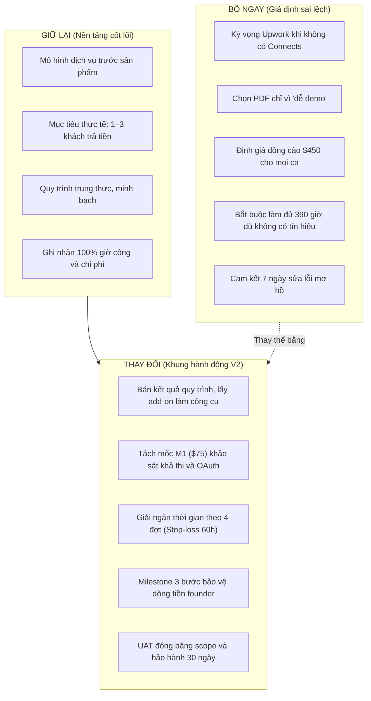

# Tổng hợp Phản biện Toàn diện Kế hoạch Triển khai SheetAutomate.com

> **Tài liệu tham chiếu:**
> - Kế hoạch gốc: [KE_HOACH_TRIEN_KHAI_SHEETAUTOMATE.md](./KE_HOACH_TRIEN_KHAI_SHEETAUTOMATE.md)
> - Khung hành động sau phản biện (V2): [KHUNG_HANH_DONG_SHEETAUTOMATE_V2.md](./KHUNG_HANH_DONG_SHEETAUTOMATE_V2.md)
> - Quá trình thực hiện: Thực hiện thông qua **Herdr** điều phối trực tiếp với **Agent Codex** (OpenAI Codex CLI - mô hình GPT-6.1-Sol, pane `w1G:p1`).

---

## I. Tổng quan Quá trình Phản biện qua Herdr

Quá trình phản biện được thực hiện tự động và tương tác đa vòng giữa **Antigravity (agy)** và **Codex** trong môi trường multiplexer **Herdr**:
1. **Vòng 1 (Stress-test & Devil's Advocate):** Codex rà soát toàn bộ kế hoạch gốc, tra cứu tài liệu thực tế của Google Workspace, chính sách Upwork Connects, điều khoản cộng đồng Reddit và giá của các đối thủ trực tiếp (Autocrat, Document Studio). Chỉ ra các điểm nghẽn, giả định màu hồng và lỗ hổng chí tử có thể khiến dự án thất bại ngay tháng đầu tiên.
2. **Vòng 2 (Mitigation & Counter-measures):** Thử thách lại các giả định và yêu cầu Codex xây dựng khung giải pháp khắc phục khả thi, định vị lại offer, lập cơ chế stop-loss theo giờ thực tế và quy trình kỹ thuật để bảo vệ founder.
3. **Vòng 3 (Đóng gói & Hoàn thiện):** Codex đã xuất bản [KHUNG_HANH_DONG_SHEETAUTOMATE_V2.md](./KHUNG_HANH_DONG_SHEETAUTOMATE_V2.md) và tài liệu này tổng hợp toàn bộ các luận điểm phản biện, câu hỏi sống còn, ma trận rủi ro và các thay đổi bắt buộc.

---

## II. Chi tiết Phản biện 5 Trụ cột Rủi ro Cốt lõi

### Trụ cột 1: Mô hình & Định giá — Nghịch lý Phạm vi (Scope Paradox)

#### 1. Phạm vi thiết kế để bảo vệ kỹ thuật, không phải để khách mua
- Kế hoạch gốc giới hạn: 1 trang, 20 trường cố định, không bảng động, không tính giá, không tự gửi email.
- **Nghịch lý chí tử:**
  - *Việc đủ đơn giản để làm nhanh:* Khách hàng có thể tự giải quyết bằng add-on miễn phí trong 10 phút.
  - *Việc đủ đau để khách trả $450:* Đòi hỏi bảng dòng hàng động (line items), gửi email đính kèm PDF cho khách hàng, tính toán chiết khấu hoặc đồng bộ CRM — những thứ kế hoạch đã gạt ra ngoài phạm vi.
- Kế hoạch đang chọn việc **dễ làm cho founder** thay vì giải quyết nỗi đau khiến khách chịu móc hầu bao.

#### 2. Đối thủ trực tiếp chưa được nhận diện đúng
- Kế hoạch so sánh với Sheetgo ($35–$50/tháng) và Coefficient, nhưng đối thủ trực diện của việc gen PDF từ Sheet lại là:
  - **Autocrat (New Visions CloudLab):** Hoàn toàn miễn phí, hỗ trợ merge dữ liệu từ Sheet sang Google Docs/PDF, hỗ trợ trigger khi submit Form và tự động gửi email.
  - **Document Studio (Digital Inspiration):** $79.95/năm (Standard) hoặc $99.95/năm (Enterprise), đầy đủ tính năng tạo PDF hàng loạt, chữ ký, webhook, gửi mail.
- Khi khách hàng hỏi: *"Tại sao tôi phải trả $450 cho bạn trong khi Document Studio chỉ $80 cả năm và Autocrat miễn phí?"*, kế hoạch cũ hoàn toàn không có câu trả lời thuyết phục bằng ngôn ngữ của người mua.

#### 3. Thiếu lý do chọn người mới 0 review
- Demo dữ liệu giả chỉ chứng minh người làm biết lập trình, không chứng minh được:
  - Khả năng xử lý dữ liệu bẩn trong thực tế.
  - Sự am hiểu về bảo mật Google Workspace của doanh nghiệp.
  - Cam kết hỗ trợ khi hệ thống gặp sự cố trong giờ làm việc của khách.
- Thị trường Upwork tràn ngập freelancer có hàng trăm review 5 sao sẵn sàng nhận script Apps Script tương tự với giá $30–$100.

---

### Trụ cột 2: Kênh Tìm khách & Bài toán Ngân sách Connects

#### 1. Ngân sách $40 Connects không đủ kích thước mẫu
- Upwork bán Connects với giá $0.15/connect. Một job Google Sheets/Automation hiện thường yêu cầu 12–16 Connects để nộp proposal.
- $40/tháng chỉ tương đương khoảng 16 proposal.
- **Mô phỏng xác suất toán học:**
  - Nếu tỷ lệ chốt (win rate) là 1%: Kỳ vọng có 0.16 hợp đồng (xác suất có ít nhất 1 hợp đồng là ~15%).
  - Nếu tỷ lệ chốt là 3%: Kỳ vọng có 0.48 hợp đồng (xác suất có ít nhất 1 hợp đồng là ~39%).
  - Nếu tỷ lệ chốt là 5%: Kỳ vọng có 0.80 hợp đồng (xác suất có ít nhất 1 hợp đồng là ~56%).
- Với một profile mới toanh (0 review, 0 badge), tỷ lệ proposal được client mở xem (view rate) thường dưới 15%. Rất có thể cả 16 proposal đều không được client mở ra đọc, dẫn đến việc mất trắng $40 mà không thu được bất kỳ dữ liệu nào.

#### 2. Lỗ hổng chẩn đoán phễu (Funnel Diagnostic Blindness)
- Kế hoạch chỉ đo "gửi proposal" và "có hội thoại", gộp chung mọi thất bại thành "chưa có phản hồi".
- Cần phân biệt rõ từng tầng chuyển đổi trên Upwork Stats:
  1. Proposal được gửi $\rightarrow$ Client mở xem (nếu không mở $\rightarrow$ lỗi ở 2 dòng đầu proposal hoặc profile title/rate).
  2. Client mở xem $\rightarrow$ Mời phỏng vấn (nếu không mời $\rightarrow$ demo/pitch không đánh trúng bài toán).
  3. Phỏng vấn $\rightarrow$ Gửi đề xuất/báo giá (nếu dừng $\rightarrow$ sai lệch về ngân sách/thời gian).
  4. Báo giá $\rightarrow$ Ký hợp đồng (nếu mất $\rightarrow$ rào cản niềm tin hoặc đối thủ rẻ hơn).

#### 3. Kênh dự phòng thiếu tính khả thi
- Đưa "cộng đồng Reddit/Facebook" làm dự phòng nhưng không tính đến chính sách chống spam.
  - Reddit cấm tự quảng cáo và spam (Reddit Spam Policy); các subreddit như r/googlesheets, r/smallbusiness cấm đăng bài chào mời dịch vụ thương mại.
- Đối tác Workspace: Người triển khai có tiếng sẽ không mạo hiểm giới thiệu khách cho một freelancer mới chưa có case study xác thực.

---

### Trụ cột 3: Kỹ thuật, OAuth & Rủi ro Môi trường Thực tế

#### 1. OAuth "Unverified App" và Quyền Quản trị Workspace (Admin Control)
- Hai ngộ nhận kỹ thuật phổ biến:
  - *Sai lầm 1:* Cho rằng script nào khách chạy cũng hiện cảnh báo.
  - *Sai lầm 2:* Cho rằng chuyển mã nguồn sang tài khoản khách là chắc chắn hết cảnh báo.
- **Thực tế:**
  - Google phân loại cảnh báo dựa trên tài khoản phát hành, scopes nhạy cảm (Google Drive, Gmail, Spreadsheets) và cấu hình Workspace.
  - Nếu khách hàng là doanh nghiệp có quản trị viên IT (Google Workspace Admin), chính sách bảo mật của tổ chức có thể **chặn hoàn toàn (block)** việc người dùng ủy quyền cho các script/ứng dụng bên ngoài chưa qua thẩm duyệt (Workspace App Access Control).
  - Khách hàng không thể tự bỏ qua màn hình đỏ hoặc không có quyền cấp quyền. Nếu đã nhận cọc và viết code xong mà khách không chạy được do chính sách công ty, dự án vỡ trận và founder phải hoàn tiền sau khi đã mất hàng chục giờ công.

#### 2. Lỗi giữa chừng và tính không nguyên tử (Non-atomic Failures)
- Luồng tạo PDF thường gồm 3 bước:
  1. Đọc dữ liệu từ Sheet $\rightarrow$ Kiểm tra hợp lệ.
  2. Tạo tài liệu Google Docs $\rightarrow$ Xuất PDF lưu vào Google Drive.
  3. Ghi link Drive và thời gian hoàn tất ngược lại Google Sheet.
- Nếu Bước 2 thành công (file PDF đã được tạo trên Drive) nhưng Bước 3 gặp sự cố (mạng rớt, script chạm timeout 6 phút, Sheet bị khóa):
  - Người dùng thấy báo lỗi và bấm chạy lại.
  - Kết quả: Drive bị nhân bản file rác, dữ liệu trạng thái bị lệch. Khóa chạy đồng thời (LockService) không giải quyết được lỗi phục hồi giữa chừng nếu không có mã định danh bản ghi (stable Record ID) và cơ chế đối soát (idempotency check).

#### 3. Độ khó thực tế của định dạng dữ liệu (Data Formatting)
- Giới hạn "20 trường" không bảo đảm tài liệu không bị lỗi:
  - Một trường địa chỉ quá dài có thể phá vỡ bố cục và làm tràn trang PDF từ 1 trang thành 2 trang.
  - Định dạng ngày tháng: `03/04/2026` (Mỹ hiểu là 4 tháng 3, châu Âu/Việt Nam hiểu là 3 tháng 4).
  - Số 0 đầu mã hóa đơn/mã bưu chính (`00123` bị Sheet tự động chuyển thành `123`).
  - Dấu chấm/phẩy phân cách hàng nghìn và số thập phân theo locale (`1,000.50` vs `1.000,50`).

---

### Trụ cột 4: Kinh tế học Founder & Cơ chế Stop-loss

#### 1. Biên lợi nhuận không gánh nổi chi phí tìm khách
- Giả định kịch bản 1 pilot $450:
  - Doanh thu: $450.
  - Phí Upwork (15%): -$67.50.
  - Chi phí trực tiếp: -$10.
  - Công founder (14 giờ $\times$ $25/giờ): -$350.
  - **Còn lại trước chi phí chung:** **$22.50**.
- Khoản dư $22.50 này chỉ đủ trả cho **0.9 giờ** (54 phút) công tìm khách!
- Chỉ cần founder bỏ ra 2 giờ để chat, gửi proposal hoặc họp video với khách, dự án đã chính thức **lỗ kinh tế**.

#### 2. Mức thu nhập thực tế cực thấp nếu tính đủ giờ
- Kế hoạch dự kiến 30 giờ/tuần $\times$ 13 tuần = 390 giờ.
- Theo kịch bản tiền mặt của kế hoạch:
  - Có 1 khách: Dòng tiền ròng sau chi phí công cụ là $82.50 $\rightarrow$ **$0.21 USD/giờ công**.
  - Có 3 khách: Dòng tiền ròng là $847.50 $\rightarrow$ **$2.17 USD/giờ công**.
- Với mức định giá nội bộ $25/giờ, 390 giờ tương đương khoản đầu tư cơ hội trị giá **$9,750 USD**. Kế hoạch không thể chỉ nhìn vào trần tiền mặt $300 mà coi nhẹ hàng trăm giờ công sức bỏ ra.

#### 3. Bẫy "Thành công giả" và Stop-loss quá muộn
- Mục tiêu "có 1–3 khách sau 90 ngày" rất dễ tạo cảm giác thành công giả nếu:
  - Mỗi khách làm một kiểu khác nhau, không tái sử dụng được gì.
  - Khách mua chỉ vì được giảm giá sâu, sau đó không dùng tiếp.
- Mốc đánh giá "ngày 90" là quá muộn, khiến founder dễ rơi vào bẫy tâm lý "cố thêm một tuần nữa để chỉnh sửa offer", dẫn đến hao mòn năng lượng và tài chính.

---

### Trụ cột 5: UAT, Bàn giao & Nguy cơ Thất thoát Công sức

#### 1. "7 ngày sửa lỗi" không khớp với chu kỳ sử dụng thực tế
- Nếu quy trình tài liệu chỉ chạy vào ngày cuối tháng để chốt lương/hóa đơn, trong 7 ngày đầu khách hàng thậm chí chưa chạy thật lần nào.
- Nếu ngày thứ 25 khách mới chạy và phát hiện lỗi, việc từ chối hỗ trợ sẽ dẫn đến tranh chấp và đánh giá 1 sao; nếu hỗ trợ miễn phí thì phá vỡ giới hạn cam kết.

#### 2. "Một vòng chỉnh sửa" là khái niệm mơ hồ
- Một vòng chỉnh sửa có thể là "đổi màu 1 nút bấm" hoặc một danh sách gồm "35 yêu cầu căn chỉnh lại layout".
- Khách hàng nói: *"Địa chỉ công ty bị nhảy dòng là lỗi của bạn"*; founder nói: *"Dữ liệu thực tế của bạn dài gấp đôi mẫu ban đầu"*. Đây là tranh chấp về yêu cầu chứ không phải bug phần mềm.

#### 3. Mất đòn bẩy thu 50% tiền cuối khi bàn giao trên tài khoản khách
- Vì script và Sheet được cài trực tiếp vào Google Drive của khách để UAT, khách hàng đã nắm toàn bộ giải pháp trong tay trước khi thanh toán khoản cuối.
- Nếu khách im lặng, trì hoãn nghiệm thu hoặc viện cớ bận, founder mất trắng 50% tiền còn lại mà không có đòn bẩy nào để thu hồi (trừ khi cố tình khóa quyền — hành vi bị Upwork và khách hàng coi là vi phạm nghiêm trọng).
- Trên Upwork, khách có tới **14 ngày** để duyệt milestone sau khi nộp bài.

#### 4. Rủi ro Installable Trigger gắn với tài khoản cá nhân
- Google quy định: Installable Trigger (chạy khi có Form submit hoặc theo thời gian) sẽ chạy dưới danh tính của người tạo ra nó.
- Nếu founder tạo trigger trong quá trình setup rồi bàn giao Sheet cho khách, khi thu hồi quyền của founder, toàn bộ trigger sẽ **lập tức ngừng hoạt động**.

---

## III. 5 Nhóm Câu hỏi Sống còn Chất vấn Founder

| STT | Trụ cột | Câu hỏi chất vấn mang tính sống còn |
| :---: | :--- | :--- |
| **1** | **Mô hình & Giá** | Tại sao khách hàng phải trả $450 cho bạn thay vì trả $80/năm cho Document Studio hoặc thuê freelancer 5 sao có sẵn review với giá $50 trên Upwork? |
| **2** | **Kênh phân phối** | Với 0 review và không chi tiền mua Connects, chính xác thì mỗi tuần bạn tiếp cận bao nhiêu người mua có thẩm quyền duyệt chi, và họ đến từ kênh cụ thể nào? |
| **3** | **Kỹ thuật & Admin** | Nếu tài khoản Google Workspace của khách bị Admin bật chính sách chặn ứng dụng bên ngoài (App Access Control), bạn xử lý thế nào để không phải hoàn tiền sau khi đã viết xong code? |
| **4** | **Kinh tế học** | Bạn sẵn sàng chấp nhận bao nhiêu giờ công tối đa cho 1 pilot trước khi dừng lại, và mức thu nhập thực nhận tối thiểu/giờ mà bạn chấp nhận là bao nhiêu? |
| **5** | **UAT & Thu tiền** | Làm sao để đảm bảo thu được 100% tiền khi toàn bộ mã nguồn và bảng tính đã nằm trong tài khoản Google Drive của khách ngay từ bước UAT? |

---

## IV. Khung Giải pháp Khắc phục & Hoàn thiện Kế hoạch

*(Đúc kết từ [KHUNG_HANH_DONG_SHEETAUTOMATE_V2.md](./KHUNG_HANH_DONG_SHEETAUTOMATE_V2.md))*

### 1. Tái định vị Offer: Bán kết quả quy trình, lấy đối thủ làm công cụ
- **Thông điệp bán hàng mới:**
  > *"I set up or repair one Google Workspace document workflow: from a form submission or approved Sheet record to a checked PDF, with its file link and status recorded. Your team gets a tested workflow in your account and a clear handover."*
- **Nguyên tắc triển khai:** Không tự viết code từ đầu nếu công cụ có sẵn (Autocrat, Document Studio) đã đáp ứng. Trung thực nhận mình là chuyên gia thiết lập và đảm bảo quy trình vận hành trơn tru.
- **Phân tách 2 gói dịch vụ rõ ràng:**
  - **Gói 1: Setup/Repair ($450):** Tối ưu/cấu hình công cụ sẵn, tối đa 7 giờ trực tiếp, cảnh báo khi chạm 5.5 giờ.
  - **Gói 2: Custom Bounded (từ $750):** Chỉ nhận sau khi có bước khảo sát trả phí, tối đa 12 giờ trực tiếp, cảnh báo khi chạm 9.5 giờ.

### 2. Chiến lược Tiếp cận khi 0 Review và Không Mua Connects
- Chuyển Upwork thành kênh phụ (chỉ nhận invitation hoặc tận dụng connects miễn phí có sẵn, không phụ thuộc).
- Tập trung vào các kênh tuyển dụng trực tiếp (direct hiring posts, contractor forms) của các doanh nghiệp dịch vụ nhỏ.
- Đề xuất làm thầu phụ (subcontractor) cho các agency chuyên triển khai Google Workspace/No-code đã có sẵn tệp khách hàng.
- Bằng chứng thay thế review: 1 video demo 60 giây + 1 video xử lý tình huống dữ liệu lỗi và khôi phục + checklist nghiệm thu UAT minh bạch.

### 3. Quy trình Onboarding Kỹ thuật & Khảo sát Trả phí (Preflight Check)
- **Tách mốc M1 ($75) thành gói khảo sát khả thi có trả phí:**
  - Khảo sát loại tài khoản (Gmail cá nhân hay Workspace doanh nghiệp).
  - Kiểm tra quyền quản trị Admin và chính sách OAuth.
  - Chạy thử 1 luồng mẫu với dữ liệu giả ngay trong môi trường của khách để xác nhận không bị chặn.
  - Kết luận **Go / No-go**: Nếu No-go do rào cản chính sách IT, khách chỉ trả $75 cho báo cáo khảo sát; founder không bị lỗ công build phần mềm.

### 4. Cơ chế Stop-loss Giải ngân Giờ theo Đợt (Tổng trần 60 giờ)
Không làm dàn trải 390 giờ trong 90 ngày. Thay vào đó, chia thành 4 đợt với trần giờ nghiêm ngặt:
- **Đợt A (12 giờ):** Nghiên cứu thị trường $\rightarrow$ Phải tìm được ít nhất 3 bài toán có nhu cầu thực tế. Nếu không $\rightarrow$ đổi bài toán.
- **Đợt B (20 giờ):** Tiếp cận 20 mục tiêu $\rightarrow$ Phải có ít nhất 3 phản hồi tích cực. Nếu không $\rightarrow$ sửa kênh/thông điệp.
- **Đợt C (20 giờ):** Gửi tối đa 3 đề xuất $\rightarrow$ Phải chốt được ít nhất 1 mốc khảo sát trả phí ($75).
- **Đợt D (8 giờ):** Đánh giá quyết định $\rightarrow$ Nếu chạm trần 60 giờ (hoặc 30 ngày) mà chưa có bất kỳ đồng tiền nào được thanh toán/funded $\rightarrow$ **DỪNG NGAY LẬP TỨC**, không kéo dài vô hạn.

### 5. Cấu trúc Milestone 3 Bước & Điều khoản UAT Chặt chẽ
- **Cấu trúc mốc tiền:**
  - **M1 ($75):** Feasibility & Preflight check (thu tiền trước khi khảo sát).
  - **M2 ($300 / $525):** Build & Test trên môi trường khách (yêu cầu funding/thanh toán trước khi viết code).
  - **M3 ($75 / $150):** Bàn giao, nghiệm thu độc lập và video hướng dẫn (khoản cuối nhỏ để giảm thiểu rủi ro thất thoát).
- **Quy chuẩn UAT:**
  - Đóng băng phạm vi (Scope Freeze) bằng văn bản trước M2: chốt danh sách trường, độ dài tối đa, định dạng locale.
  - Một vòng chỉnh sửa giao diện được định nghĩa cụ thể: tối đa 5 điểm thay đổi nhỏ, trong giới hạn 1 giờ làm việc.
  - Bảo hành: Đổi từ "7 ngày sửa lỗi" thành "30 ngày bảo hành lỗi sai lệch so với đặc tả", phản hồi trong 1–2 ngày làm việc; không bao gồm các yêu cầu phát sinh mới.
  - Kiểm tra bàn giao độc lập: Thu hồi quyền của founder, hướng dẫn tài khoản khách tự kích hoạt trigger và tự chạy thành công.

---

## V. Ma trận Rủi ro & Kế hoạch Phản ứng Toàn diện

| Rủi ro & Dấu hiệu nhận biết | Mức tác động | Biện pháp Phòng ngừa | Hành động Ứng phó khi xảy ra |
| :--- | :---: | :--- | :--- |
| **Không có người mua scope đóng gói** | **Nghiêm trọng** | Phỏng vấn bài toán thực tế trước khi chốt tính năng | Dừng offer sau khi tiếp cận 5 cuộc trao đổi mà không có fit |
| **Add-on sẵn đáp ứng tốt, custom mất giá** | **Cao** | Khảo sát đối thủ kỹ lưỡng, bán dịch vụ setup trung thực | Hướng dẫn khách dùng công cụ sẵn, chỉ tính phí cài đặt |
| **0 Connects / Proposal không được xem** | **Cao** | Chuyển sang kênh direct hiring và tìm đối tác đại lý | Dừng nộp Upwork mù quáng; chuyển toàn bộ giờ sang outbound |
| **Cộng đồng cấm tiếp cận/quảng cáo** | **Cao** | Đọc kỹ quy định subreddit/group trước khi đăng | Rút lui ngay lập tức; không cố tình spam để tránh bị report |
| **Admin Workspace/OAuth chặn script** | **Nghiêm trọng** | Mốc M1 ($75) chạy thử quyền bằng tài khoản đại diện | Tạm dừng dự án, báo No-go, xuất báo cáo và không thu tiền build |
| **Dữ liệu lỗi / Mở quyền file công khai sai** | **Nghiêm trọng** | Validation chặt chẽ, áp dụng quyền tối thiểu (Least Privilege) | Dừng luồng ngay, thu hồi quyền link, sửa lỗi và UAT lại |
| **Quota timeout / Lỗi giữa chừng tạo file** | **Cao** | Cấp Record ID duy nhất, kiểm tra idempotency, log chi tiết | Đối soát ID trên Sheet trước khi chạy lại; chia nhỏ lô xử lý |
| **PDF vỡ layout / Lỗi định dạng ngày/số** | **Cao** | Thử nghiệm với chuỗi ký tự dài nhất và locale thực tế của khách | Sửa lỗi nếu thuộc baseline; lập change request nếu dữ liệu vượt chuẩn |
| **Vượt giờ dự toán, biên lợi nhuận âm** | **Cao** | Đặt ngưỡng cảnh báo sớm (5.5h gói nhỏ, 9.5h gói lớn) | Hoàn thành nghĩa vụ cam kết; tăng giá hoặc siết scope cho đơn sau |
| **Khách đổi phạm vi / Chậm phản hồi** | **Cao** | Quy định đầu mối duyệt duy nhất, thời hạn phản hồi 3 ngày | Tạm dừng tiến độ (pause project); lập change request tính phí |
| **Khách không nghiệm thu / Tranh chấp tiền** | **Nghiêm trọng** | Thu trước từng mốc, chỉ làm việc khi milestone đã funded | Dừng công việc chưa thanh toán; giải quyết theo cơ chế nền tảng |
| **Khách không tự vận hành được sau bàn giao**| **Cao** | Kiểm tra độc lập sau khi founder đã thu hồi toàn bộ quyền | Cập nhật lại tài liệu bàn giao; hướng dẫn tạo trigger dưới tài khoản khách |

---

## VI. Bảng Tổng kết Hành động: Giữ gì — Bỏ gì — Thay gì

### 7 Việc Cần Làm Ngay Trước Ngày Thứ Nhất

1. **Viết lại Offer 3 câu:** Tập trung vào giải quyết quy trình (từ Form/Sheet ra PDF kiểm chuẩn và bàn giao), không nói về công nghệ.
2. **Khởi tạo Tracker 3 tab:** Theo dõi chi tiết phễu khách hàng, từng mốc giải ngân tiền và ghi nhận trung thực từng giờ công của founder.
3. **Cố định ngưỡng Stop-loss:** Đóng dấu trần đầu tư vòng 1 là **60 giờ làm việc** và **100 USD chi phí** trong tối đa 30 ngày.
4. **Chuẩn bị Scope & UAT 1 trang:** Sẵn sàng mẫu tài liệu đóng băng phạm vi (giới hạn ký tự, locale, 5 điểm sửa đổi).
5. **Tiếp cận bài toán thực trước khi làm website:** Dành 12 giờ đầu tiên để tìm ít nhất 3 yêu cầu mua thực tế; không lãng phí 8 giờ đầu vào thiết kế website.
6. **Xây demo đúng trọng tâm:** Chỉ làm demo sau khi đã thấy nhu cầu; video demo không quá 90 giây và phải có cảnh xử lý dữ liệu lỗi.
7. **Luôn thu tiền M1 trước khi code:** Tuyệt đối không bắt đầu viết bất kỳ dòng mã nguồn nào trước khi mốc khảo sát khả thi được chấp thuận và funded.
